# System Architecture

This document describes the architectural design, component responsibilities, data flow, and IPC boundary of Kai Terminal.

---

## 1. High-Level Architecture

Kai Terminal combines two complementary systems:
1. **Desktop Terminal Application**: A decoupled React webview frontend and Rust native PTY backend.
2. **Project Intelligence Core & CLI**: A lightweight, terminal-first indexer, context retriever, and Model Context Protocol (MCP) server that helps external AI coding agents understand codebases with minimal token overhead.

```mermaid
flowchart TD
    subgraph Agents["External AI Coding Agents"]
        CL["Claude Code"]
        CU["Cursor"]
        CX["Codex"]
        GM["Gemini CLI"]
        CP["Copilot / VS Code"]
        WS["Windsurf"]
        CN["Cline"]
        OC["opencode"]
        AI["Aider"]
        AG["Antigravity (agy)"]
    end

    subgraph Intelligence["Project Intelligence & MCP Layer (Node / TS)"]
        CLI["Kai CLI (bin/kai.js)"]
        MCP["MCP Server (stdio JSON-RPC)"]
        CLASS["Task Classifier"]
        RET["Relevance Retriever"]
        SKILLS["Skill Registry"]
        TEMPL["Versioned Prompt Templates"]
        INDEX["Incremental Indexer"]
    end

    subgraph Storage["Isolated Local Storage (~/.kai/)"]
        PROJ_DB["Project Indexes (projects/id/index.json)"]
        LOCK["Concurrency File Locks (.lock)"]
        METRICS["Privacy Metrics (metrics.jsonl)"]
    end

    subgraph DesktopApp["Desktop Terminal Application"]
        UI["React Frontend (Tabs, Split Panes, xterm.js WebGL)"]
        TAURI["Tauri 2 IPC Boundary"]
        RUST["Rust Native Backend (PtyManager, Shell Auto-Detect)"]
    end

    CL <-->|stdio JSON-RPC| MCP
    CU <-->|stdio JSON-RPC| MCP
    CX <-->|stdio JSON-RPC| MCP
    GM <-->|stdio JSON-RPC| MCP
    CP <-->|stdio JSON-RPC| MCP
    WS <-->|stdio JSON-RPC| MCP
    CN <-->|stdio JSON-RPC| MCP
    OC <-->|stdio JSON-RPC| MCP
    AI <-->|stdio JSON-RPC| MCP
    AG <-->|stdio JSON-RPC| MCP
    CLI --> MCP
    CLI --> CLASS
    CLASS --> RET
    RET --> TEMPL
    SKILLS --> TEMPL
    INDEX --> PROJ_DB
    INDEX --> LOCK
    RET --> PROJ_DB
    UI <--> TAURI <--> RUST
```

---

## 2. Component Layer Breakdown

### 2.1 Frontend Layer (`src/`)

- **`src/App.tsx` & `src/hooks/`**: `App` is a thin composition root; all state lives in feature hooks. `useTabs` (tab/pane state and operations), `useSessionExit` (shell-exit handling plus the crash-loop / instant-death guards), `useSessionPersistence` (saved layout, restore offer, workspaces), `useTerminalConfig` (settings, theme, shell profiles), `useCodeMode` + `useGitStatus` + `usePaneCwd` (per-terminal Code Mode footer, per-pane git badges, directory tracking; Code Mode is announced by the `kai <agent>` CLI on that pane's own output as an `OSC 1337` signal, `src/core/codeModeSignal.ts`, so it is scoped to one terminal and needs no polling), `useProjectActions` (editor / git modals), `useAppUpdates`, `useMusicPlayer`, `useWindowRefit` (blank-on-reopen fix), `usePrefetchPanels` and `useAppShortcuts` (single listener reading the latest handlers via `useLatest`). `src/components/TabPanes.tsx` renders one tab's flat pane grid and is memoized, so footer-only updates (music progress, git badge) never re-render terminals; `commandActions.tsx` builds the palette entries and `lazyPanels.ts` is the single registry of code-split panels (lazy components + idle prefetch). `src/services/tabFactory.ts` holds the pure tab construction / layout persistence helpers. `src/__tests__/appShell.test.tsx` characterizes the whole shell under jsdom (TerminalView and the lazy modals are stubbed via `src/__tests__/helpers/appStubs.ts`).
- **`src/components/TerminalView.tsx`**: Manages the xterm.js instance lifecycle with hardware-accelerated GPU WebGL rendering (`@xterm/addon-webgl`) and automatic fallback to DOM rendering when WebGL is unavailable or when opted out via `localStorage.kai_renderer="dom"`. Handles canvas sizing using `@xterm/addon-fit`, user keyboard input forwarding, custom selection copy/paste (`Ctrl+Shift+C`/`Cmd+C` copy, `Ctrl+Shift+V`/`Cmd+V` paste), and listens for `pty-output` and `pty-exit` IPC events. Output is buffered in a high-performance FIFO (`TerminalOutputBuffer`) to eliminate O(n²) string slicing under high-volume floods.
- **`src/components/TabBar.tsx`, `HeaderActions.tsx`, `PopupMenu.tsx` & `WindowControls.tsx`**: The single 38px header row (the native title bar is off; `tauri.macos.conf.json` keeps macOS traffic lights via an overlay title bar). `TabBar` renders the tabs with pointer-capture drag-to-reorder, double-click inline title editing and the `+ ▾` shell picker (WSL badges); an empty `data-tauri-drag-region` strip moves the window. `HeaderActions` adds the always-visible search box that opens the command palette, AI providers, Settings and a `⋯` menu whose entries reuse the palette's handlers and shortcuts. `PopupMenu` is the shared accessible dropdown (Escape, outside click, arrow keys, focus return). `WindowControls` draws minimize / maximize / close on Windows and Linux. There is no app icon in the header (the window icon already shows it) and a split pane has no folder heading; its `aria-label` carries the folder for screen readers. Git branch and Code Mode live only in the status bar.
- **Several windows (`src-tauri/src/terminal_windows.rs`, `src/services/terminalWindows.ts`, `tabHandoff.ts`)**: One process, many windows, the way an editor opens several. The first window is `main` (Tauri config); others are `term-<n>`, created by `open_terminal_window` from `index.html?window=terminal` (Ctrl+Shift+N, a bare re-launch handled by the single-instance plugin, or a dragged tab). Everything that must stay single (PTY manager, Shared Agent service, `~/.kai` state, the snap-layouts overlay) lives once in the process; `main` alone saves the layout and runs the music player and update checks (`secondary` in `App.tsx`). A window closes alone and the app exits with the last one (`closing_ends_app`); each PTY session records its owner window (`PtySessionHandle::owner`) and the backend ends a closed window's sessions on `Destroyed`, because React cleanup is not guaranteed when a webview is torn down. The capability `default.json` covers `main` and `term-*`. Events meant for one window use `emit_to` (`kai-open-project`, sign-in URL, maximize-button state); shared state is sent to every terminal window.
- **Moving a tab with its running shell (`tabHandoff.ts`, `HandoffGate` in `pty.rs`)**: dragging a tab out of the strip (`isTearOffZone` in `TabBar.tsx`) or "Move to new window" calls `detachTab`: (1) `pty_handoff_begin` makes the backend hold the sessions' output and exit (every session's events pass through `GatedEmitter`), (2) a short settle wait lets events already in flight arrive, (3) each `TerminalView` flushes and serializes its screen and scrollback with `@xterm/addon-serialize` (`handoffCapture`), (4) `open_terminal_window` creates the window with the snapshots as an opaque JSON seed (`WindowSeeds`, read once by `take_window_seed` before the app renders so no starter shell is spawned) and re-owns the sessions, (5) the old window lets go without closing them (`handoffRelease`). The new `TerminalView` (`adopt` prop) redraws the snapshot, calls `pty_handoff_finish` to collect what was held, writes it in order and only then goes live (live events for the session wait in the early-event buffer). If the window cannot open, `finish` returns the held output to the old terminal and the tab stays put. Held output is capped at 8 MB per session.
- **`src/components/StatusBar.tsx` & `ShellPicker.tsx`**: The footer. Left: the focused pane's shell picker, the Code Mode / Terminal pill (a button that calls `useProjectActions().openEditor`, with a `PopupMenu` caret listing editors from `detect_installed_editors_cmd`; the scan is cached per process in `shell.rs`) and the git branch badge (opens the Changes Review modal) with a refresh button. Right: the draggable music mini-player (only while a track is loaded), the version or update chip and a check-for-updates button. The default editor is `editorPath` in Settings → Shell & Tools; `GitChangesModal` opens single files through `openFileInEditor`.
- **Fonts and colour**: `src/fonts.css` bundles Inter (UI) and JetBrains Mono (terminal) as local variable woff2 files, preloaded in `src/main.tsx` before the first terminal mounts so xterm measures the right cell size. Styles live in `src/styles/` (`tokens/`, `primitives/`, `shell/`, `features/`, `themes/`; see `docs/DESIGN_SYSTEM.md`). Theme chrome tokens (`--bg-tab-bar`, `--bg-statusbar`, tab and text tokens) are in `src/styles/tokens/semantic.css` and each theme overrides them in `src/styles/themes/`; `uiRefinement.test.ts` guards their contrast and hierarchy for all 9 themes. The header, tab strip and status bar take the theme's own surface colour (`--bg-tab-bar` and `--bg-statusbar` resolve to the theme's surface). The Settings font list is a themed `PopupMenu`; `src/services/systemFonts.ts` asks the backend (`fonts.rs`, `list_system_fonts_cmd`: Windows font registry, Linux `fc-list` then font folders, macOS font folders) for installed families and keeps the clean monospace ones by measuring glyph widths. `TerminalView` repaints the pane after output that erases the screen (`outputClearsScreen` in `terminalModes.ts`).
- **`src/components/WorkspaceModal.tsx`**: Renders workspace management modal for creating, renaming, deleting, saving, and restoring named workspaces.
- **`src/services/ptyService.ts`**: Provides the `IPtyService` interface abstraction, handling native Tauri IPC calls when running inside desktop app and fallback mock PTY behavior during browser previews.
- **`src/services/paneLayout.ts`**: Handles split-pane calculations (up to 8 panes per tab, horizontal/vertical splits, fraction clamping, minimum split size floor). Panes render as a flat list of absolutely-positioned siblings with stable keys, ensuring splitting, closing, and divider dragging never remounts or drops an active terminal session. Each pane runs an independent backend PTY session ID.
- **`src/services/workspaces.ts`**: Manages workspace configuration storage (`kai_workspaces_v1`), layout restoration with restore-time revalidation, tab renaming, and safe legacy schema migration (`terminal_workspaces_v1`, `terminal_tab_layout_v1`).
- **`src/services/shortcuts.ts`**: Centralized keybinding registry for custom keyboard shortcuts (including tab/pane navigation `nextTab`, `prevTab`, `nextPane`, `prevPane`; the defaults are Windows Terminal-style and live in `DEFAULT_KEYBINDINGS` in `settingsService.ts`, which also holds `LEGACY_DEFAULT_KEYBINDINGS` and the one-time `migrateLegacyKeybindings` that moves untouched old defaults, guarded by the `_keybindingsMigrated` marker written on every save) with conflict detection and macOS key label translation. Also owns the terminal-key bindings, which are remappable through `fixedKeybindings` (`DEFAULT_FIXED_SHORTCUTS`, `resolveFixedBindings`, `validateFixedBinding`): `isCopyKeyEvent` / `isPasteKeyEvent` (default Ctrl+Shift+C/V plus the fixed Ctrl/Shift+Insert and Cmd+C/V), `matchTerminalAction` (select all, clear, scroll top/bottom — handled in `TerminalView`'s xterm key handler) and `matchBuiltinShortcut` (zoom, tab jump — handled in `App`'s global keydown after user bindings, session-only zoom via `zoomedFontSize`). Tab jump binds the modifiers; digits 1-9 follow. xterm is told not to forward these keys to the PTY.
- **`src/services/aiCliService.ts` & `projectService.ts`**: Clients for local AI CLI discovery/version/config-presence diagnostics (passive, local, non-billable; version/config never prove sign-in) and git status caching with invalidation on mutating actions.

### 2.2 IPC Boundary (`src-tauri/capabilities/`)

- **Security Sandboxing:** IPC permissions are declared in `capabilities/default.json` giving minimum necessary privileges (`core:default`).
- **Content Security Policy:** Declared in `tauri.conf.json`:
  `default-src 'self'; connect-src 'self' ipc: http://ipc.localhost https://api.github.com; script-src 'self' 'wasm-unsafe-eval'; style-src 'self' 'unsafe-inline'; font-src 'self' data:; img-src 'self' data:;` (`'wasm-unsafe-eval'` lets the inline-image add-on compile its WebAssembly decoder; JavaScript `eval` stays blocked)

#### Native IPC Commands:
- `create_pty(options)`: Spawns a shell process attached to a native PTY master/slave pair.
- `write_to_pty(id, data)`: Streams input bytes from frontend to the target PTY master writer.
- `resize_pty(id, cols, rows)`: Updates PTY window dimensions to match xterm.js layout.
- `close_pty(id)`: Kills the target shell process and cleans up session handles.
- Terminal key rules (copy, paste, AltGr, local actions, keys that belong to the app) live in `src/services/terminalKeyHandler.ts`; `TerminalView` only attaches the handler it creates. The Search, Serialize and Image add-ons are loaded on first use (`src/services/xtermLazyAddons.ts`). The WebGL renderer (attach, detach, the hidden-pane budget, the re-attach schedule) is `src/components/gpuRenderer.ts`. The output path from event to xterm (buffering, one flush per frame with a 250 ms fallback for hidden tabs, writes sliced to 64 Ki characters, acknowledgement after parsing, the skipped-output notice, the repaint after a clear) is `src/services/terminalOutputPipeline.ts`. Working-directory tracking (the spawn reply, `pty-cwd` events, OSC 7 / OSC 9;9 as a signal to read the backend, focus, the probes after a `cd` or `git checkout` line, the quiet 5 s poll, holding a changed folder back while typing) is `src/services/paneCwdTracker.ts`. Find-in-terminal (the bar, the match count, highlights cleared on every way of closing) is `src/hooks/useTerminalSearch.ts`; it and the Serialize snapshot load their add-on through `createLazyAddonSlot` (`src/services/xtermLazyAddons.ts`), which drops an add-on that finishes loading after its pane was torn down and retries a failed load. Starting a shell (the fallback to the default folder when the saved one is gone, the parent-folder notice, closing a shell whose start was overtaken) and attaching to a moved one (snapshot, then held output, then live) are `src/services/paneSpawn.ts`; `TerminalView` keeps the launch sequence numbers and React state, and both paths go live through the same `markLive` / `replayHeld` steps.
- `close_request_ack()`: The page acknowledges the `kai-close-requested` event the backend sends when the system asks a terminal window to close (Alt+F4, taskbar). The backend holds that close back (`close_requests.rs`) so the page can ask before ending running commands; no acknowledgement within 2.5 s lets the close proceed.
- `pty_ack(id, bytes)`: The frontend has handed `bytes` of the session's output to xterm; frees flow-control credit (see "Output flow control").
- `pty_busy_sessions(ids)`: Which sessions have a command running (more than an idle prompt); backs the close confirmation.
- `get_pty_cwd(id)`: Reads working directory of the running child process.
- `get_available_shells()`: Scans host system for installed shell binaries.
- `get_ai_cli_status()` / `get_ai_cli_details()`: Scans local PATH for AI CLI presence without making network calls.
- `check_ai_cli_path(customPath)`: Validates user-specified custom AI tool executable paths.
- `get_kai_cli_launch_cmd()`: Resolves executable path to the bundled or user-installed Kai CLI.
- `setup_agent_mcp_cmd(provider, projectDir)`: Safely auto-configures MCP wiring in agent config files.
- `get_agent_setup_snippet_cmd(provider, projectDir)`: Returns verified MCP configuration snippet for manual setup.
- `get_git_info_cmd(cwd)`: Inspects branch and dirty state for a target directory using system `git`.
- `run_git_action_cmd(cwd, action)`: Runs git operations (commit, push, pull, stash).
- `get_git_changes_cmd(cwd)` / `get_git_diff_cmd(cwd, file)`: Fetches file diffs and unstaged/staged status.
- `stage_git_file_cmd(cwd, file)` / `unstage_git_file_cmd(cwd, file)` / `discard_git_file_cmd(cwd, file)`: Stages, unstages, or discards file changes.
- `open_project_in_editor(editor, path)`: Opens current project in detected external editor.
- `detect_installed_editors_cmd()`: Detects available code editors on system.
- `open_external_url_cmd(url)`: Safely opens validated URLs (such as GitHub releases) in default browser.
- `get_diagnostics()`: Generates a secret-free environment summary.
- `get_system_terminal_config()`: Detects OS-specific terminal defaults (default shell, theme).
- `get_app_version()`: Returns current application version.
- `get_autostart_enabled()` / `set_autostart_enabled(enabled)`: Inspects and toggles OS login autostart.
- `get_session_info(id)` / `list_sessions()`: Returns active PTY session statistics.
- `get_project_intelligence_cmd(path)` / `get_active_project_cmd()`: Queries project indexing and Code Mode state.
- `get_kai_cli_status_cmd()` / `ensure_kai_cli_cmd()`: Verifies and installs Kai CLI launcher on first startup.
- `shared_agent_request_cmd(request)` / `shared_agent_stop_cmd()`: Sends one JSON request to the Shared Agent engine (started on first use) and returns its answer; stops the engine.
- `open_shared_chat_window()` / `close_shared_chat_window()`: Opens (or raises) and closes the popped-out Shared Agent chat window (`index.html?window=shared-chat`); the conversation is handed over through localStorage.

#### Asynchronous IPC Events:
- `pty-output`: Emitted by background reader threads whenever stdout/stderr output is read.
- `pty-exit`: Emitted when child process terminates, providing the exit code.
- `pty-cwd`: Emitted when the shell reports a new working directory (each report once).

These three events are sent to the **window that shows the session only** (`OwnerRoutes` in `pty.rs`; `emit_to`), not broadcast: an idle window receives none of another window's terminal output. The route follows the session when its tab moves to another window (`PtyManager::set_owner`, called by `open_window` and by `pty_handoff_finish` before the held output is released).
- Shared Agent events: every engine stdout line carrying an `"event"` key (chat chunks, share and host status) is pushed to the UI.

The frontend registers one Tauri listener per PTY event and fans it out to panes in JS (`src/services/ptyService.ts`), so a chunk crosses the IPC bridge once however many panes are open. The Rust output thread coalesces raw reads for a few milliseconds (up to 64 KB) into one `pty-output` event, keeping incomplete UTF-8 sequences for the next batch.

#### Output flow control
Terminal output is paced, never dropped. Per session, `FlowControl` (`pty.rs`) counts the bytes emitted to the frontend and not yet acknowledged. The frontend acknowledges bytes (`pty_ack`, batched by `src/services/outputAcker.ts`, driven by `src/services/terminalOutputPipeline.ts`) once xterm has parsed them (the `term.write` callback). At 1 MiB in flight the output thread stops emitting; the bounded queue (8 chunks) in front of it fills, the reader thread stops reading the PTY, and the child blocks on its next write like it would on any terminal that cannot keep up. It resumes at 256 KiB. Waiting never outlives the session: closing it, app exit, or the shell's output ending releases the wait, so `close_pty` and the exit event never depend on a stalled UI. Safeguards: a changed owner window resets the credit (the old window can never acknowledge), and a pause with no acknowledgement for 30 s gives the credit back (logged) so a lost acknowledgement can never freeze a terminal. Output that a window move hands over (`HandoffRelease`) was never sent as events and is not acknowledged. The frontend's own buffer (`TerminalOutputBuffer`, 8 Mi characters) is only a safety net: if it ever has to discard output, the terminal prints a visible "KB of output was skipped" notice and logs it.

Slow commands run on Tokio's blocking pool (`src-tauri/src/blocking.rs`), not on the async workers that serve keystroke writes, resizes and acknowledgements.

### 2.3 Rust Backend Layer (`src-tauri/src/`)

- **`pty.rs` (`PtyManager`)**: Manages session handles (`HashMap<String, PtySessionHandle>`) wrapped in thread-safe locks. Handles PTY spawning, 32 KiB chunked byte writing (`write_bytes_chunked`), and cleanup. On Linux under Flatpak (`FLATPAK_ID`) it routes the shell through `flatpak-spawn --host` (`flatpak_host_argv`), picks the host login shell, and primes bash with an OSC 7 `PROMPT_COMMAND` so the cwd badge follows `cd`.
- **`shell.rs`**: Cross-platform shell discovery logic for Windows (PowerShell Core, Windows PowerShell, CMD, WSL), Linux (`$SHELL`, bash, zsh, fish, sh), and macOS (`$SHELL`, zsh, Homebrew shells, bash, fish). Includes Windows build version gate checking (minimum build 17763).
- **`ai_cli.rs`**: Checks local PATH presence and config-file presence (existence only, never credential validity) for 10 catalogued AI tools (`codex`, `claude`, `gemini`, `opencode`, `copilot`, `aider`, `cursor`, `windsurf`, `cline`, `agy`), running safe, bounded `--version` checks (5 s timeout, kill+reap, no shell, no network, nothing secret logged). Version success never implies authentication.
- **`git.rs`**: Reads branch/dirty state using local system `git` plumbing (no shell, 8 s timeout per invocation, kill+reap, stderr discarded). Reports detached HEAD, unborn branches, untracked/modified/deleted files; worktrees, nested repos, and unusual paths; graceful taxonomy for missing git / bad dirs.
- **`kai_cli.rs`**: Auto-installs and self-repairs `kai` CLI user PATH integration on first launch across Windows, macOS, and Linux.
- **`cli_guard.rs`**: Desktop/CLI collision prevention redirecting terminal-style subcommands (`code`, `status`, `query`, `agent setup`, etc.) from desktop GUI binary to Node CLI.
- **`job_runner.rs`**: Windows Job Object helper for `kai run` (`kai.exe --kai-job-probe | --kai-job-run | --kai-job-kill`, handled in `main` before any window). The command runs in a named job, so a timeout or abort stops every process it started, detached ones included. The CLI side is `src/core/windowsJob.ts`.
- **`music_relay.rs`**: Serves one static page on `http://localhost:<random port>` that hosts the YouTube embed and relays its postMessage traffic, so the music player can control YouTube where the app's own origin (`tauri://localhost` on macOS / Linux) is refused.
- **`shared_agent.rs`**: Supervises the Shared Agent engine, one long-lived Node process (`dist/cli/shared-agent.js`, bundled next to the CLI) spoken to in JSON lines over stdin/stdout. It starts on the first request, is stopped gracefully when the app exits, and ends itself if the pipe closes. The webview never touches the network; all Shared Agent networking happens in that process.
- **`error.rs`**: Strongly typed Rust error definitions returned via IPC.

### 2.4 Project Intelligence & MCP Layer (`src/core/`, `src/cli/`, `bin/kai.js`)

- **`src/core/registry.ts`**: Manages isolated storage in `~/.kai/projects/<id>/` outside target repositories. `resolveProjectRoot` maps any path inside a git work tree to the work tree's top folder (unless that folder is too broad to index), so one repository has one graph; registering it removes older graphs of its own subfolders (`removeSubsumedRegistrations`), and `pruneProjectRegistrations` backs `kai graph prune`. Implements canonical path hashing, schema-versioned metadata, atomic JSON writes (`atomicWriteJson`), and file locks (`ProjectLock`) preventing indexing collisions.
- **`src/core/indexer.ts`**: Bounded, non-evaluating incremental scanner with `mtimeMs`, `ctimeMs`, and `sizeBytes` cache validation. Extracts symbols (functions, classes, interfaces) and dependencies across TypeScript, Rust, Python, Go. Enforces canonical project boundary checks, prototype-safe dictionaries (`Object.create(null)`), rejects symlink escapes, skips binary files, and filters sensitive credentials (`.env*`, `id_rsa*`, tokens).
- **`src/core/classifier.ts`**: Deterministic rule-based task classifier categorizing prompts into 8 task domains (`explain`, `implement`, `debug`, `refactor`, `test`, `review`, `architecture`, `documentation`) or `unknown` with input length bounds (4,000 characters) and confidence scoring.
- **`src/core/templates.ts`**: Versioned (`v1.0.0`) prompt templates that preserve the user's intent verbatim and structure task guidelines, project rules, source references, and line ranges.
- **`src/core/skills.ts`**: On-demand skill registry matching relevant coding conventions based on task category, language, and keywords under strict token limits without code execution.
- **`src/core/retrieval.ts`**: Deterministic relevance search over index data only: symbol words weighted by rarity, filename and dependency matches. A whole identifier typed in the query that names an indexed symbol anchors the request: the words obtained by splitting it keep a quarter of their path/import credit, files matching only on them fall below a raised relevance floor, and for refactor/debug/implement/test tasks a bounded one-hop expansion adds callers and tests from the import graph (`expandNeighbors`, capped, one summary omission for the rest). Extracts focused line ranges around symbols and validates live on-disk file SHA-256 digests against index snapshots to flag stale files.
- **`src/core/contextAssembler.ts`**: Orchestrates classification, freshness checks, rule extraction, retrieval, and skills into a structured `ContextPackage`. Enforces the token budget as a hard guarantee on the rendered prompt (drops skills, lowest-scored sources, then rules; hard-truncates only as a last resort — the verbatim task section leads so it survives).
- **`src/core/codeModeWorkflow.ts`**: Orchestrates Code Mode task planning (`planCodeTask`) with selected-file prioritization, dependency/caller/test expansion, and freshness-gated context. Manages the project graph sync lifecycle (`runCodeTaskWithAutoSync`, `syncProjectGraph`) with concurrent rebuild deduplication, atomic dual-copy persistence checks (`checkPersistenceConsistency`), status transitions (`markProjectGraphStatus`), file locks, generation guards, bounded untracked file walking, and safe process execution for external coding agents.
- **`src/core/mcp.ts`**: Standard Model Context Protocol (MCP) server communicating over `stdio` JSON-RPC with stream-level 10 MB line limits (`BoundedLineTransform`) and strict workspace boundary confinement. Exposes read-only tools on project sources: `kai_project_info`, `kai_search_code`, `kai_find_symbol`, `kai_get_dependencies`, `kai_get_context`, `kai_refresh_index`, `kai_get_lsp_status`, `kai_plan_task`, and `kai_sync_graph`. Graph-dependent reads automatically gate freshness and execute bounded auto-refreshes when out of date.
- **`src/core/sharedAgent/`**: The Shared Agent engine. `types.ts` and `invite.ts` are pure and shared with the UI; `service.ts` owns joined hosts, chat with a joined PC's agent (no local fallback) and the optional host; `hostServer.ts` is the LAN/tunnel HTTP host (Kai-to-Kai only, end-to-end encrypted by `secureChannel.ts`: X25519 handshake pinned to the host key in the invite link, AES-256-GCM calls on `/api/sc/*`; same-subnet checks in `netcheck.ts`, hashed invites and tokens in `hostStore.ts`); `agentRunner.ts` runs Claude Code / OpenCode read-only in an empty folder with the prompt on stdin; `events.ts` turns their machine output into wire events; `client.ts` is the receiving side; `serve.ts` is the JSON-lines process loop started by `src/cli/sharedAgentMain.ts`. Security model: `SECURITY.md` section 5.
- **`src/core/integrations/`**: Provider-neutral layer that connects a folder to an external service (Azure DevOps today). `providerCatalog.ts` is pure data shared with the UI; `types.ts` holds the provider contract and normalized shapes; `config.ts` keeps global accounts (`~/.kai/config.json`) apart from the single per-folder binding (`~/.kai/projects/<id>/integration.json`, one object, so two active integrations are impossible by construction); `secretStore.ts` stores tokens in the OS secret store (DPAPI / Keychain / Secret Service) with a `0600` file fallback (macOS Keychain writes pipe commands over stdin with `security -i` to prevent token exposure in process argv tables); `http.ts` is the one bounded client (timeouts, size cap, retry on throttling, secrets redacted); `service.ts` implements login, switch, remove, access checks, the merge branch (`branches`, `set_rules`) and the desktop `rpc` once for every entry point; `workflowRules.ts` is pure (shared with the UI) and holds the per-folder merge branch and its validation; the `kai_workflow_rules` tool returns it (or the repository's default branch); `tools.ts` defines the provider-neutral MCP tools, listed by `mcp.ts` only for a connected folder; `providers/azure-devops/` holds remote parsing, auth (with in-flight `az` token request deduplication), REST calls and mappers (including `assertWiqlProjectScope` enforcing project isolation against custom WIQL queries). Adding a service is a new `providers/<name>/` folder plus one catalog entry. The desktop app is a thin shell over `kai azure rpc` (one JSON request on stdin, one JSON line out; `src-tauri/src/integrations.rs`), so no integration logic is duplicated in Rust or React.
- **`src/cli/index.ts` & `bin/kai.js`**: Unified CLI dispatcher providing terminal commands for project registration (`code`), external agent execution with automated graph sync (`run`), task planning (`plan`), full index rebuilds (`graph rebuild`), status inspection (`status`), unregistration (`unregister`), querying (`query`), benchmarking (`bench`), integration setup and management (`kai integration`, `kai azure`), and automated agent setup (`kai agent setup <agent|all>`). Ensures clean process tree termination (SIGTERM -> 2s -> SIGKILL, `taskkill /PID /T /F` on Windows) and preserves agent exit codes.
  - Layout: `index.ts` is only the dispatcher (boundary rules, `EXTERNAL_COMMANDS` permitting integration commands in any standard shell without requiring `KAI_TERMINAL=1`, removed-command hints, routing) and the direct-run guard. Each command lives in `src/cli/commands/` (`desktop`, `remove`, `graph`, `config`, `session`, `mcp`, `list`, `agent`, `advanced`, `diagnostics`, plus `integration` for `kai integration list|<provider>`, `provider` for `kai <provider> list|active|remove` and the desktop app's `rpc`, and `integrationShared` for their flag parsing and pickers); shared pieces are `agentWorkflow.ts` (agent resolution, run + setup workflows), `desktopApp.ts` (desktop binary discovery and launch), `doctor.ts`, `help.ts`, `activeProject.ts`, `sessionFiles.ts`, `kaiConfig.ts` and `args.ts`. The bundle has two entry points: `dist/cli/index.js` (the `kai` CLI) and `dist/cli/shared-agent.js` (the Shared Agent engine, started only by the desktop app), with shared chunks in `dist/cli/chunks/`.

### 2.5 What runs while Kai is idle

Each optional subsystem starts only when something needs it. This table is the intended behaviour, read from the code paths below; it is **not** a measurement (counting processes over ten idle minutes is still on the test plan), so keep it in step with the code when a new background activity is added.

| Activity | When it runs | Cost while idle |
|---|---|---|
| PTY sessions | per open shell: a reader, a coalescer and a waiter thread | blocked on the shell's output; nothing polls |
| Call watcher (`call_watch.rs`) | only while Settings enable a call-pause feature (`call_watch_set_enabled`) | the thread sleeps; no probes while disabled |
| Folder poll | every 5 s per visible pane (stopped while the window is hidden): one IPC call to the backend, answered from its stored value | an unchanged folder is ignored; the poll never triggers a git probe by itself |
| Git branch badge | on a directory change, window focus, and shortly after a submitted `git ...`/`cd ...` line or a shell prompt (at most one forced probe per directory every 2.5 s) | no timer; no probe while the window is hidden |
| Update check | about 45 s after launch (when none ran in 24 h), then every 6 h while the window is open; off with **Automatically check for updates** | one HTTPS request to GitHub's releases API |
| Saved layout | 500 ms after the last tab change, and when the window hides | none |
| Music player | only after it is opened: the YouTube connection hint, the embed and, on macOS/Linux, the local relay page | none before |
| Shared Agent | only while sharing is turned on in the current session | none before |
| `kai mcp` server (separate process, started by an AI agent) | polls which integration tools the folder is bound to every 2 s | reads binding files; spawns no `git` per poll (the project root is resolved once and re-checked every 5 min) |
| Language-server detection (`kai_get_lsp_status`) | on request; the answer is cached for 5 min | probes run in parallel and off the event loop |
| Bundled-Node update check | a weekly GitHub Actions job, never in the app | none |

---

## 3. Security & Safety Principles

1. **Direct Argv Execution:** Commands are launched directly using `portable-pty`'s `CommandBuilder` with explicit argument arrays (no shell string evaluation).
2. **Local Execution Only:** The application operates strictly on the local machine with standard user permissions. No remote code execution or unauthenticated network listeners exist.
3. **Non-Execution Invariant for Project Content:** Indexed project files, scripts, and build commands are NEVER executed during scanning or retrieval. All parsing is passive and lexical.
4. **Symlink & Traversal Boundaries:** Scanners canonicalize paths with `fs.realpathSync` and verify the target resides within the authorized project root before reading.
5. **Secret Filtering & Bounded Streams:** `.env*`, `id_rsa*`, private keys, and credential stores are excluded by default. MCP stdio stream bounds prevent memory exhaustion from oversized inputs.
6. **No Secret Persistence:** Input keystrokes, environment variable maps, scrollback contents, and credentials are never written to disk or telemetry files. Diagnostic metrics in `~/.kai/metrics.jsonl` record only performance metadata (latency, file counts, token estimates), never user prompts or source code.
7. **Graceful Fallbacks:** If a custom shell, git binary, or AI tool is missing, the application falls back safely with informative diagnostics rather than crashing.
