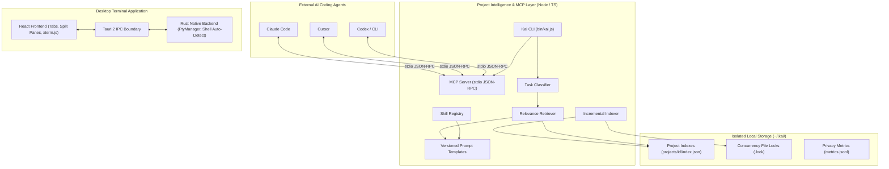

# System Architecture

This document describes the architectural design, component responsibilities, data flow, and IPC boundary of Kai Terminal.

---

## 1. High-Level Architecture

Kai Terminal combines two complementary systems:
1. **Desktop Terminal Application**: A decoupled React webview frontend and Rust native PTY backend.
2. **Project Intelligence Core & CLI**: A lightweight, terminal-first indexer, context retriever, and Model Context Protocol (MCP) server that helps external AI coding agents understand codebases with minimal token overhead.

---

## 2. Component Layer Breakdown

### 2.1 Frontend Layer (`src/`)

- **`src/components/TerminalView.tsx`**: Manages the xterm.js instance lifecycle, canvas sizing using `@xterm/addon-fit`, user keyboard input forwarding, custom selection copy/paste (`Ctrl+Shift+C`/`Cmd+C` copy, `Ctrl+Shift+V`/`Cmd+V` paste), and listens for `pty-output` and `pty-exit` IPC events.
- **`src/components/TabBar.tsx` & `Toolbar.tsx`**: Renders multi-tab interface with double-click inline tab title editing, shell selection dropdown with WSL badges, initial directory selector, git branch badge, and settings toggles.
- **`src/components/WorkspaceModal.tsx`**: Renders workspace management modal for creating, renaming, deleting, saving, and restoring named workspaces.
- **`src/services/ptyService.ts`**: Provides the `IPtyService` interface abstraction, handling native Tauri IPC calls when running inside desktop app and fallback mock PTY behavior during browser previews.
- **`src/services/paneLayout.ts`**: Handles split-pane calculations (up to 4 panes per tab, horizontal/vertical splits, fraction clamping). Each pane runs an independent backend PTY session ID.
- **`src/services/workspaces.ts`**: Manages workspace configuration storage (`kai_workspaces_v1`), layout restoration, tab renaming, and safe legacy schema migration (`terminal_workspaces_v1`).
- **`src/services/shortcuts.ts`**: Centralized keybinding registry for custom keyboard shortcuts (including tab/pane navigation `nextTab`, `prevTab`, `nextPane`) with conflict detection and macOS key label translation.
- **`src/services/aiCliService.ts` & `projectService.ts`**: Clients for local AI CLI presence checking, non-modifying local auth checks, and git repository status caching.

### 2.2 IPC Boundary (`src-tauri/capabilities/`)

- **Security Sandboxing:** IPC permissions are declared in `capabilities/default.json` giving minimum necessary privileges (`core:default`).
- **Content Security Policy:** Declared in `tauri.conf.json`:
  `default-src 'self'; script-src 'self'; style-src 'self' 'unsafe-inline'; font-src 'self' data:;`

#### Native IPC Commands:
- `create_pty(options)`: Spawns a shell process attached to a native PTY master/slave pair.
- `write_to_pty(id, data)`: Streams input bytes from frontend to the target PTY master writer.
- `resize_pty(id, cols, rows)`: Updates PTY window dimensions to match xterm.js layout.
- `close_pty(id)`: Kills the target shell process and cleans up session handles.
- `get_available_shells()`: Scans host system for installed shell binaries.
- `get_ai_cli_status()` / `get_ai_cli_details()`: Scans local PATH for AI CLI presence without making network calls.
- `get_git_info_cmd(cwd)`: Inspects branch and dirty state for a target directory using system `git`.
- `get_diagnostics()`: Generates a secret-free environment summary.

#### Asynchronous IPC Events:
- `pty-output`: Emitted by background reader threads whenever stdout/stderr output is read.
- `pty-exit`: Emitted when child process terminates, providing the exit code.

### 2.3 Rust Backend Layer (`src-tauri/src/`)

- **`pty.rs` (`PtyManager`)**: Manages session handles (`HashMap<String, PtySessionHandle>`) wrapped in thread-safe locks. Handles PTY spawning, chunked byte writing (`write_bytes_chunked`), and cleanup.
- **`shell.rs`**: Cross-platform shell discovery logic for Windows (PowerShell Core, Windows PowerShell, CMD, WSL), Linux (`$SHELL`, bash, zsh, fish, sh), and macOS (`$SHELL`, zsh, Homebrew shells, bash, fish). Includes Windows build version gate checking (minimum build 17763).
- **`ai_cli.rs`**: Checks local PATH presence and runs safe, bounded `--version` checks (with an 8-second execution timeout and auto-reap) for optional local AI tools.
- **`git.rs`**: Reads current branch name and status using local system `git` commands with timeout bounds.
- **`error.rs`**: Strongly typed Rust error definitions returned via IPC.

### 2.4 Project Intelligence & MCP Layer (`src/core/`, `src/cli/`, `bin/kai.js`)

- **`src/core/registry.ts`**: Manages isolated storage in `~/.kai/projects/<id>/` outside target repositories. Implements canonical path hashing, schema-versioned metadata, atomic JSON writes (`atomicWriteJson`), and file locks (`ProjectLock`) preventing indexing collisions.
- **`src/core/indexer.ts`**: Bounded, non-evaluating incremental scanner. Extracts symbols (functions, classes, interfaces) and dependencies across TypeScript, Rust, Python, Go. Enforces canonical project boundary checks, rejects symlink escapes, skips binary files, and filters sensitive credentials (`.env*`, `id_rsa*`, tokens).
- **`src/core/classifier.ts`**: Deterministic rule-based task classifier categorizing prompts into 8 task domains (`explain`, `implement`, `debug`, `refactor`, `test`, `review`, `architecture`, `documentation`) or `unknown` with confidence scoring and caller overrides.
- **`src/core/templates.ts`**: Versioned (`v1.0.0`) prompt templates that preserve the user's intent verbatim and structure task guidelines, project rules, source references, and line ranges.
- **`src/core/skills.ts`**: On-demand skill registry matching relevant coding conventions based on task category, language, and keywords under strict token limits without code execution.
- **`src/core/retrieval.ts`**: Deterministic relevance search prioritizing exact symbol matches (10.0), filename matches (5.0), and dependencies. Extracts focused line ranges (-15 to +45 lines) around symbols.
- **`src/core/contextAssembler.ts`**: Orchestrates classification, freshness checks, rule extraction, retrieval, and skills into a structured `ContextPackage`. Enforces the token budget as a hard guarantee on the rendered prompt (drops skills, lowest-scored sources, then rules; hard-truncates only as a last resort — the verbatim task section leads so it survives).
- **`src/core/tokenCounter.ts`**: Deterministic `cl100k` token estimation distinguishing estimates from exact tokenizer measurements.
- **`src/core/mcp.ts`**: Standard Model Context Protocol (MCP) server communicating over `stdio` JSON-RPC. Exposes 6 read-only tools: `kai_project_info`, `kai_search_code`, `kai_find_symbol`, `kai_get_dependencies`, `kai_get_context`, and `kai_refresh_index`.
- **`src/cli/index.ts` & `bin/kai.js`**: Unified CLI dispatcher providing terminal commands for project registration, status inspection, unregistration (`unregister` deletes only Kai-owned data under `~/.kai/projects/`), querying, benchmarking, and agent setup.

---

## 3. Security & Safety Principles

1. **Direct Argv Execution:** Commands are launched directly using `portable-pty`'s `CommandBuilder` with explicit argument arrays (no shell string evaluation).
2. **Local Execution Only:** The application operates strictly on the local machine with standard user permissions. No remote code execution or unauthenticated network listeners exist.
3. **Non-Execution Invariant for Project Content:** Indexed project files, scripts, and build commands are NEVER executed during scanning or retrieval. All parsing is passive and lexical.
4. **Symlink & Traversal Boundaries:** Scanners canonicalize paths with `fs.realpathSync` and verify the target resides within the authorized project root before reading.
5. **Secret Filtering:** `.env*`, `id_rsa*`, private keys, and credential stores are excluded by default.
6. **No Secret Persistence:** Input keystrokes, environment variable maps, scrollback contents, and credentials are never written to disk or telemetry files. Diagnostic metrics in `~/.kai/metrics.jsonl` record only performance metadata (latency, file counts, token estimates), never user prompts or source code.
7. **Graceful Fallbacks:** If a custom shell, git binary, or AI tool is missing, the application falls back safely with informative diagnostics rather than crashing.
