# System Architecture

This document describes the architectural design, component responsibilities, data flow, and IPC boundary of Kai Terminal.

---

## 1. High-Level Architecture

Kai Terminal combines two complementary systems:
1. **Desktop Terminal Application**: A decoupled React webview frontend and Rust native PTY backend.
2. **Project Intelligence Core & CLI**: A lightweight, terminal-first indexer, context retriever, and Model Context Protocol (MCP) server that helps external AI coding agents understand codebases with minimal token overhead.

```mermaid
flowchart TD
    subgraph Agents["External AI Coding Agents"]
        CL["Claude Code"]
        CU["Cursor"]
        CX["Codex"]
        GM["Gemini CLI"]
        CP["Copilot / VS Code"]
        WS["Windsurf"]
        CN["Cline"]
        OC["opencode"]
        AI["Aider"]
        AG["Antigravity (agy)"]
    end

    subgraph Intelligence["Project Intelligence & MCP Layer (Node / TS)"]
        CLI["Kai CLI (bin/kai.js)"]
        MCP["MCP Server (stdio JSON-RPC)"]
        CLASS["Task Classifier"]
        RET["Relevance Retriever"]
        SKILLS["Skill Registry"]
        TEMPL["Versioned Prompt Templates"]
        INDEX["Incremental Indexer"]
    end

    subgraph Storage["Isolated Local Storage (~/.kai/)"]
        PROJ_DB["Project Indexes (projects/id/index.json)"]
        LOCK["Concurrency File Locks (.lock)"]
        METRICS["Privacy Metrics (metrics.jsonl)"]
    end

    subgraph DesktopApp["Desktop Terminal Application"]
        UI["React Frontend (Tabs, Split Panes, xterm.js WebGL)"]
        TAURI["Tauri 2 IPC Boundary"]
        RUST["Rust Native Backend (PtyManager, Shell Auto-Detect)"]
    end

    CL <-->|stdio JSON-RPC| MCP
    CU <-->|stdio JSON-RPC| MCP
    CX <-->|stdio JSON-RPC| MCP
    GM <-->|stdio JSON-RPC| MCP
    CP <-->|stdio JSON-RPC| MCP
    WS <-->|stdio JSON-RPC| MCP
    CN <-->|stdio JSON-RPC| MCP
    OC <-->|stdio JSON-RPC| MCP
    AI <-->|stdio JSON-RPC| MCP
    AG <-->|stdio JSON-RPC| MCP
    CLI --> MCP
    CLI --> CLASS
    CLASS --> RET
    RET --> TEMPL
    SKILLS --> TEMPL
    INDEX --> PROJ_DB
    INDEX --> LOCK
    RET --> PROJ_DB
    UI <--> TAURI <--> RUST
```

---

## 2. Component Layer Breakdown

### 2.1 Frontend Layer (`src/`)

- **`src/App.tsx` & `src/hooks/`**: `App` is a thin composition root; all state lives in feature hooks. `useTabs` (tab/pane state and operations), `useSessionExit` (shell-exit handling plus the crash-loop / instant-death guards), `useSessionPersistence` (saved layout, restore offer, workspaces), `useTerminalConfig` (settings, theme, shell profiles), `useCodeMode` + `useGitStatus` + `usePaneCwd` (Code Mode footer, per-pane git badges, directory tracking), `useProjectActions` (editor / git modals), `useAppUpdates`, `useMusicPlayer`, `useWindowRefit` (blank-on-reopen fix), `usePrefetchPanels` and `useAppShortcuts` (single listener reading the latest handlers via `useLatest`). `src/components/TabPanes.tsx` renders one tab's flat pane grid and is memoized, so footer-only updates (music progress, git badge) never re-render terminals; `commandActions.tsx` builds the palette entries and `lazyPanels.ts` is the single registry of code-split panels (lazy components + idle prefetch). `src/services/tabFactory.ts` holds the pure tab construction / layout persistence helpers. `src/__tests__/appShell.test.tsx` characterizes the whole shell under jsdom (TerminalView and the lazy modals are stubbed via `src/__tests__/helpers/appStubs.ts`).
- **`src/components/TerminalView.tsx`**: Manages the xterm.js instance lifecycle with hardware-accelerated GPU WebGL rendering (`@xterm/addon-webgl`) and automatic fallback to DOM rendering when WebGL is unavailable or when opted out via `localStorage.kai_renderer="dom"`. Handles canvas sizing using `@xterm/addon-fit`, user keyboard input forwarding, custom selection copy/paste (`Ctrl+Shift+C`/`Cmd+C` copy, `Ctrl+Shift+V`/`Cmd+V` paste), and listens for `pty-output` and `pty-exit` IPC events. Output is buffered in a high-performance FIFO (`TerminalOutputBuffer`) to eliminate O(n²) string slicing under high-volume floods.
- **`src/components/TabBar.tsx` & `Toolbar.tsx`**: Renders multi-tab interface with pointer-capture drag-to-reorder, double-click inline tab title editing, shell selection dropdown with WSL badges, initial directory selector, git branch badge, and settings toggles.
- **`src/components/WorkspaceModal.tsx`**: Renders workspace management modal for creating, renaming, deleting, saving, and restoring named workspaces.
- **`src/services/ptyService.ts`**: Provides the `IPtyService` interface abstraction, handling native Tauri IPC calls when running inside desktop app and fallback mock PTY behavior during browser previews.
- **`src/services/paneLayout.ts`**: Handles split-pane calculations (up to 8 panes per tab, horizontal/vertical splits, fraction clamping, minimum split size floor). Panes render as a flat list of absolutely-positioned siblings with stable keys, ensuring splitting, closing, and divider dragging never remounts or drops an active terminal session. Each pane runs an independent backend PTY session ID.
- **`src/services/workspaces.ts`**: Manages workspace configuration storage (`kai_workspaces_v1`), layout restoration with restore-time revalidation, tab renaming, and safe legacy schema migration (`terminal_workspaces_v1`, `terminal_tab_layout_v1`).
- **`src/services/shortcuts.ts`**: Centralized keybinding registry for custom keyboard shortcuts (including tab/pane navigation `nextTab`, `prevTab`, `nextPane`) with conflict detection and macOS key label translation. Also owns the terminal-key bindings, which are remappable through `fixedKeybindings` (`DEFAULT_FIXED_SHORTCUTS`, `resolveFixedBindings`, `validateFixedBinding`): `isCopyKeyEvent` / `isPasteKeyEvent` (default Ctrl+Shift+C/V plus the fixed Ctrl/Shift+Insert and Cmd+C/V), `matchTerminalAction` (select all, clear, scroll top/bottom — handled in `TerminalView`'s xterm key handler) and `matchBuiltinShortcut` (zoom, tab jump — handled in `App`'s global keydown after user bindings, session-only zoom via `zoomedFontSize`). Tab jump binds the modifiers; digits 1-9 follow. xterm is told not to forward these keys to the PTY.
- **`src/services/aiCliService.ts` & `projectService.ts`**: Clients for local AI CLI discovery/version/config-presence diagnostics (passive, local, non-billable; version/config never prove sign-in) and git status caching with invalidation on mutating actions.

### 2.2 IPC Boundary (`src-tauri/capabilities/`)

- **Security Sandboxing:** IPC permissions are declared in `capabilities/default.json` giving minimum necessary privileges (`core:default`).
- **Content Security Policy:** Declared in `tauri.conf.json`:
  `default-src 'self'; connect-src 'self' ipc: http://ipc.localhost https://api.github.com; script-src 'self'; style-src 'self' 'unsafe-inline'; font-src 'self' data:; img-src 'self' data:;`

#### Native IPC Commands:
- `create_pty(options)`: Spawns a shell process attached to a native PTY master/slave pair.
- `write_to_pty(id, data)`: Streams input bytes from frontend to the target PTY master writer.
- `resize_pty(id, cols, rows)`: Updates PTY window dimensions to match xterm.js layout.
- `close_pty(id)`: Kills the target shell process and cleans up session handles.
- `get_pty_cwd(id)`: Reads working directory of the running child process.
- `get_available_shells()`: Scans host system for installed shell binaries.
- `get_ai_cli_status()` / `get_ai_cli_details()`: Scans local PATH for AI CLI presence without making network calls.
- `check_ai_cli_path(customPath)`: Validates user-specified custom AI tool executable paths.
- `get_kai_cli_launch_cmd()`: Resolves executable path to the bundled or user-installed Kai CLI.
- `setup_agent_mcp_cmd(provider, projectDir)`: Safely auto-configures MCP wiring in agent config files.
- `get_agent_setup_snippet_cmd(provider, projectDir)`: Returns verified MCP configuration snippet for manual setup.
- `get_git_info_cmd(cwd)`: Inspects branch and dirty state for a target directory using system `git`.
- `run_git_action_cmd(cwd, action)`: Runs git operations (commit, push, pull, stash).
- `get_git_changes_cmd(cwd)` / `get_git_diff_cmd(cwd, file)`: Fetches file diffs and unstaged/staged status.
- `stage_git_file_cmd(cwd, file)` / `unstage_git_file_cmd(cwd, file)` / `discard_git_file_cmd(cwd, file)`: Stages, unstages, or discards file changes.
- `open_project_in_editor(editor, path)`: Opens current project in detected external editor.
- `detect_installed_editors_cmd()`: Detects available code editors on system.
- `open_external_url_cmd(url)`: Safely opens validated URLs (such as GitHub releases) in default browser.
- `get_diagnostics()`: Generates a secret-free environment summary.
- `get_system_terminal_config()`: Detects OS-specific terminal defaults (default shell, theme).
- `get_app_version()`: Returns current application version.
- `get_autostart_enabled()` / `set_autostart_enabled(enabled)`: Inspects and toggles OS login autostart.
- `get_session_info(id)` / `list_sessions()`: Returns active PTY session statistics.
- `get_project_intelligence_cmd(path)` / `get_active_project_cmd()`: Queries project indexing and Code Mode state.
- `get_kai_cli_status_cmd()` / `ensure_kai_cli_cmd()`: Verifies and installs Kai CLI launcher on first startup.

#### Asynchronous IPC Events:
- `pty-output`: Emitted by background reader threads whenever stdout/stderr output is read.
- `pty-exit`: Emitted when child process terminates, providing the exit code.

### 2.3 Rust Backend Layer (`src-tauri/src/`)

- **`pty.rs` (`PtyManager`)**: Manages session handles (`HashMap<String, PtySessionHandle>`) wrapped in thread-safe locks. Handles PTY spawning, 32 KiB chunked byte writing (`write_bytes_chunked`), and cleanup. On Linux under Flatpak (`FLATPAK_ID`) it routes the shell through `flatpak-spawn --host` (`flatpak_host_argv`), picks the host login shell, and primes bash with an OSC 7 `PROMPT_COMMAND` so the cwd badge follows `cd`.
- **`shell.rs`**: Cross-platform shell discovery logic for Windows (PowerShell Core, Windows PowerShell, CMD, WSL), Linux (`$SHELL`, bash, zsh, fish, sh), and macOS (`$SHELL`, zsh, Homebrew shells, bash, fish). Includes Windows build version gate checking (minimum build 17763).
- **`ai_cli.rs`**: Checks local PATH presence and config-file presence (existence only, never credential validity) for 10 catalogued AI tools (`codex`, `claude`, `gemini`, `opencode`, `copilot`, `aider`, `cursor`, `windsurf`, `cline`, `agy`), running safe, bounded `--version` checks (5 s timeout, kill+reap, no shell, no network, nothing secret logged). Version success never implies authentication.
- **`git.rs`**: Reads branch/dirty state using local system `git` plumbing (no shell, 8 s timeout per invocation, kill+reap, stderr discarded). Reports detached HEAD, unborn branches, untracked/modified/deleted files; worktrees, nested repos, and unusual paths; graceful taxonomy for missing git / bad dirs.
- **`kai_cli.rs`**: Auto-installs and self-repairs `kai` CLI user PATH integration on first launch across Windows, macOS, and Linux.
- **`cli_guard.rs`**: Desktop/CLI collision prevention redirecting terminal-style subcommands (`code`, `status`, `query`, `agent setup`, etc.) from desktop GUI binary to Node CLI.
- **`error.rs`**: Strongly typed Rust error definitions returned via IPC.

### 2.4 Project Intelligence & MCP Layer (`src/core/`, `src/cli/`, `bin/kai.js`)

- **`src/core/registry.ts`**: Manages isolated storage in `~/.kai/projects/<id>/` outside target repositories. Implements canonical path hashing, schema-versioned metadata, atomic JSON writes (`atomicWriteJson`), and file locks (`ProjectLock`) preventing indexing collisions.
- **`src/core/indexer.ts`**: Bounded, non-evaluating incremental scanner with `mtimeMs`, `ctimeMs`, and `sizeBytes` cache validation. Extracts symbols (functions, classes, interfaces) and dependencies across TypeScript, Rust, Python, Go. Enforces canonical project boundary checks, prototype-safe dictionaries (`Object.create(null)`), rejects symlink escapes, skips binary files, and filters sensitive credentials (`.env*`, `id_rsa*`, tokens).
- **`src/core/classifier.ts`**: Deterministic rule-based task classifier categorizing prompts into 8 task domains (`explain`, `implement`, `debug`, `refactor`, `test`, `review`, `architecture`, `documentation`) or `unknown` with input length bounds (4,000 characters) and confidence scoring.
- **`src/core/templates.ts`**: Versioned (`v1.0.0`) prompt templates that preserve the user's intent verbatim and structure task guidelines, project rules, source references, and line ranges.
- **`src/core/skills.ts`**: On-demand skill registry matching relevant coding conventions based on task category, language, and keywords under strict token limits without code execution.
- **`src/core/retrieval.ts`**: Deterministic relevance search over index data only: symbol words weighted by rarity, filename and dependency matches. A whole identifier typed in the query that names an indexed symbol anchors the request: the words obtained by splitting it keep a quarter of their path/import credit, files matching only on them fall below a raised relevance floor, and for refactor/debug/implement/test tasks a bounded one-hop expansion adds callers and tests from the import graph (`expandNeighbors`, capped, one summary omission for the rest). Extracts focused line ranges around symbols and validates live on-disk file SHA-256 digests against index snapshots to flag stale files.
- **`src/core/contextAssembler.ts`**: Orchestrates classification, freshness checks, rule extraction, retrieval, and skills into a structured `ContextPackage`. Enforces the token budget as a hard guarantee on the rendered prompt (drops skills, lowest-scored sources, then rules; hard-truncates only as a last resort — the verbatim task section leads so it survives).
- **`src/core/codeModeWorkflow.ts`**: Orchestrates Code Mode task planning (`planCodeTask`) with selected-file prioritization, dependency/caller/test expansion, and freshness-gated context. Manages the project graph sync lifecycle (`runCodeTaskWithAutoSync`, `syncProjectGraph`) with concurrent rebuild deduplication, atomic dual-copy persistence checks (`checkPersistenceConsistency`), status transitions (`markProjectGraphStatus`), file locks, generation guards, bounded untracked file walking, and safe process execution for external coding agents.
- **`src/core/mcp.ts`**: Standard Model Context Protocol (MCP) server communicating over `stdio` JSON-RPC with stream-level 10 MB line limits (`BoundedLineTransform`) and strict workspace boundary confinement. Exposes read-only tools on project sources: `kai_project_info`, `kai_search_code`, `kai_find_symbol`, `kai_get_dependencies`, `kai_get_context`, `kai_refresh_index`, `kai_get_lsp_status`, `kai_plan_task`, and `kai_sync_graph`. Graph-dependent reads automatically gate freshness and execute bounded auto-refreshes when out of date.
- **`src/cli/index.ts` & `bin/kai.js`**: Unified CLI dispatcher providing terminal commands for project registration (`code`), external agent execution with automated graph sync (`run`), task planning (`plan`), full index rebuilds (`graph rebuild`), status inspection (`status`), unregistration (`unregister`), querying (`query`), benchmarking (`bench`), and automated agent setup (`kai agent setup <agent|all>`). Ensures clean process tree termination (SIGTERM -> 2s -> SIGKILL, `taskkill /PID /T /F` on Windows) and preserves agent exit codes.
  - Layout: `index.ts` is only the dispatcher (boundary rules, removed-command hints, routing) and the direct-run guard. Each command lives in `src/cli/commands/` (`desktop`, `remove`, `graph`, `config`, `session`, `mcp`, `list`, `agent`, `advanced`, `diagnostics`); shared pieces are `agentWorkflow.ts` (agent resolution, run + setup workflows), `desktopApp.ts` (desktop binary discovery and launch), `doctor.ts`, `help.ts`, `activeProject.ts`, `sessionFiles.ts`, `kaiConfig.ts` and `args.ts`. The bundle is still a single `dist/cli/index.js`.

---

## 3. Security & Safety Principles

1. **Direct Argv Execution:** Commands are launched directly using `portable-pty`'s `CommandBuilder` with explicit argument arrays (no shell string evaluation).
2. **Local Execution Only:** The application operates strictly on the local machine with standard user permissions. No remote code execution or unauthenticated network listeners exist.
3. **Non-Execution Invariant for Project Content:** Indexed project files, scripts, and build commands are NEVER executed during scanning or retrieval. All parsing is passive and lexical.
4. **Symlink & Traversal Boundaries:** Scanners canonicalize paths with `fs.realpathSync` and verify the target resides within the authorized project root before reading.
5. **Secret Filtering & Bounded Streams:** `.env*`, `id_rsa*`, private keys, and credential stores are excluded by default. MCP stdio stream bounds prevent memory exhaustion from oversized inputs.
6. **No Secret Persistence:** Input keystrokes, environment variable maps, scrollback contents, and credentials are never written to disk or telemetry files. Diagnostic metrics in `~/.kai/metrics.jsonl` record only performance metadata (latency, file counts, token estimates), never user prompts or source code.
7. **Graceful Fallbacks:** If a custom shell, git binary, or AI tool is missing, the application falls back safely with informative diagnostics rather than crashing.
