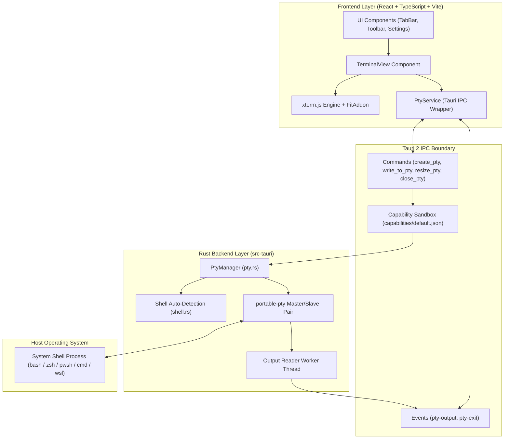

# System Architecture

This document describes the architectural design, component responsibilities, data flow, and IPC boundary of Kai Terminal.

---

## 1. High-Level Architecture

Kai Terminal uses a decoupled architecture separating the React webview frontend from the Rust native backend.

---

## 2. Component Layer Breakdown

### 2.1 Frontend Layer (`src/`)

- **`src/components/TerminalView.tsx`**: Manages the xterm.js instance lifecycle, canvas sizing using `@xterm/addon-fit`, user keyboard input forwarding, custom selection copy/paste (`Ctrl+Shift+C`/`Cmd+C` copy, `Ctrl+Shift+V`/`Cmd+V` paste), and listens for `pty-output` and `pty-exit` IPC events.
- **`src/components/TabBar.tsx` & `Toolbar.tsx`**: Renders multi-tab interface with double-click inline tab title editing, shell selection dropdown with WSL badges, initial directory selector, git branch badge, and settings toggles.
- **`src/components/WorkspaceModal.tsx`**: Renders workspace management modal for creating, renaming, deleting, saving, and restoring named workspaces.
- **`src/services/ptyService.ts`**: Provides the `IPtyService` interface abstraction, handling native Tauri IPC calls when running inside desktop app and fallback mock PTY behavior during browser previews.
- **`src/services/paneLayout.ts`**: Handles split-pane calculations (up to 4 panes per tab, horizontal/vertical splits, fraction clamping). Each pane runs an independent backend PTY session ID.
- **`src/services/workspaces.ts`**: Manages workspace configuration storage (`kai_workspaces_v1`), layout restoration, tab renaming, and safe legacy schema migration (`terminal_workspaces_v1`).
- **`src/services/shortcuts.ts`**: Centralized keybinding registry for custom keyboard shortcuts (including tab/pane navigation `nextTab`, `prevTab`, `nextPane`) with conflict detection and macOS key label translation.
- **`src/services/aiCliService.ts` & `projectService.ts`**: Clients for local AI CLI presence checking, non-modifying local auth checks, and git repository status caching.

### 2.2 IPC Boundary (`src-tauri/capabilities/`)

- **Security Sandboxing:** IPC permissions are declared in `capabilities/default.json` giving minimum necessary privileges (`core:default`).
- **Content Security Policy:** Declared in `tauri.conf.json`:
  `default-src 'self'; script-src 'self'; style-src 'self' 'unsafe-inline'; font-src 'self' data:;`

#### Native IPC Commands:
- `create_pty(options)`: Spawns a shell process attached to a native PTY master/slave pair.
- `write_to_pty(id, data)`: Streams input bytes from frontend to the target PTY master writer.
- `resize_pty(id, cols, rows)`: Updates PTY window dimensions to match xterm.js layout.
- `close_pty(id)`: Kills the target shell process and cleans up session handles.
- `get_available_shells()`: Scans host system for installed shell binaries.
- `get_ai_cli_status()` / `get_ai_cli_details()`: Scans local PATH for AI CLI presence without making network calls.
- `get_git_info_cmd(cwd)`: Inspects branch and dirty state for a target directory using system `git`.
- `get_diagnostics()`: Generates a secret-free environment summary.

#### Asynchronous IPC Events:
- `pty-output`: Emitted by background reader threads whenever stdout/stderr output is read.
- `pty-exit`: Emitted when child process terminates, providing the exit code.

### 2.3 Rust Backend Layer (`src-tauri/src/`)

- **`pty.rs` (`PtyManager`)**: Manages session handles (`HashMap<String, PtySessionHandle>`) wrapped in thread-safe locks. Handles PTY spawning, chunked byte writing (`write_bytes_chunked`), and cleanup.
- **`shell.rs`**: Cross-platform shell discovery logic for Windows (PowerShell Core, Windows PowerShell, CMD, WSL), Linux (`$SHELL`, bash, zsh, fish, sh), and macOS (`$SHELL`, zsh, Homebrew shells, bash, fish). Includes Windows build version gate checking (minimum build 17763).
- **`ai_cli.rs`**: Checks local PATH presence and runs safe, bounded `--version` checks (with an 8-second execution timeout and auto-reap) for optional local AI tools.
- **`git.rs`**: Reads current branch name and status using local system `git` commands with timeout bounds.
- **`error.rs`**: Strongly typed Rust error definitions returned via IPC.

---

## 3. Security & Safety Principles

1. **Direct Argv Execution:** Commands are launched directly using `portable-pty`'s `CommandBuilder` with explicit argument arrays (no shell string evaluation).
2. **Local Execution Only:** The application operates strictly on the local machine with standard user permissions. No remote code execution or background servers are included.
3. **No Secret Persistence:** Input keystrokes, environment variable maps, scrollback contents, and credentials are never written to disk or telemetry files.
4. **Graceful Fallbacks:** If a custom shell, git binary, or AI tool is missing, the application falls back safely with informative diagnostics rather than crashing.
