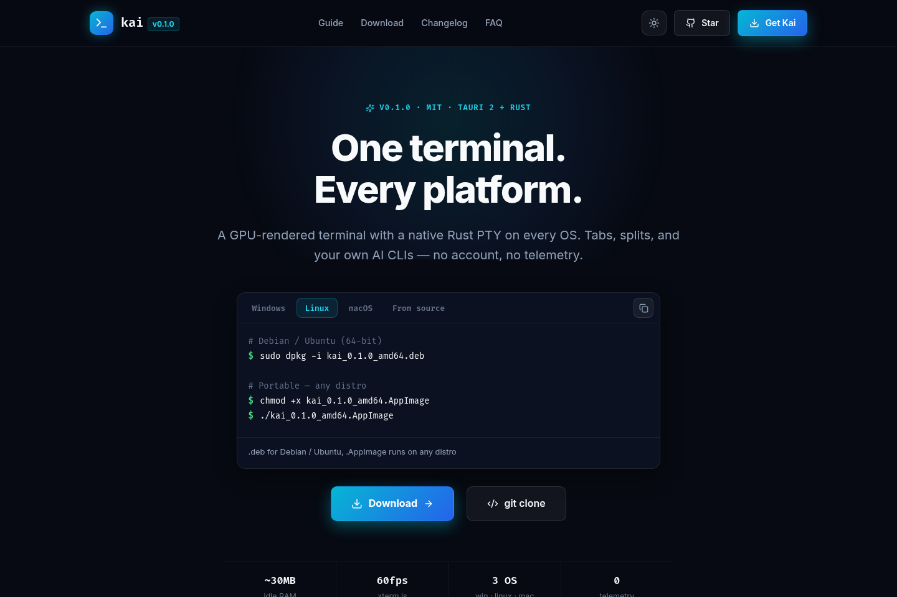

# kai — One terminal. Every platform.

[](https://github.com/surajthaqurie/kai-terminal/actions)
[](LICENSE)
[](https://github.com/surajthaqurie/kai-terminal/releases/latest)
[](https://kai-terminal.vercel.app/)

Desktop terminal for **Windows · Linux · macOS**, plus a local CLI for AI context.
Tauri 2 + Rust (`portable-pty`) + `xterm.js`. MIT licensed, no account.

Live site: **https://kai-terminal.vercel.app/** · Releases: [latest](https://github.com/surajthaqurie/kai-terminal/releases/latest)

> Status: v0.1.0 is an early release. If something breaks, please open an issue with OS, version and steps to reproduce.

[](https://kai-terminal.vercel.app/)

## Download — you pick the file

No auto-detection here. All installers are published on [GitHub Releases](https://github.com/surajthaqurie/kai-terminal/releases/latest). Pick your own:

| OS                  | File                                | Install                                            |
| ------------------- | ----------------------------------- | -------------------------------------------------- |
| macOS 12+ (M1–M4)   | `kai_0.1.0_aarch64.dmg`             | Open the `.dmg`, drag `Kai.app` to `/Applications` |
| Linux x64           | `kai_0.1.0_amd64.deb`               | `sudo dpkg -i kai_0.1.0_amd64.deb`                 |
| Linux (any distro)  | `kai_0.1.0_amd64.AppImage`          | `chmod +x kai_*.AppImage && ./kai_*.AppImage`      |
| Linux ARM64         | `kai_0.1.0_arm64.deb` / `.AppImage` | Same as above, ARM build                           |
| Windows 10/11 x64   | `kai_0.1.0_x64-setup.exe`           | Download and run                                   |
| Windows x64 (admin) | `kai_0.1.0_x64_en-US.msi`           | For silent/admin installs                          |

The website lists the same files and does not choose for you. If your browser guessed wrong, just click another tab — nothing is locked in.

## Run from source

```bash
git clone https://github.com/surajthaqurie/kai-terminal.git
cd kai-terminal
npm install
npm run tauri dev   # desktop, hot reload
```

Prereqs: Node 20+ · Rust 1.75+. Linux also needs:

```bash
sudo apt-get install -y build-essential pkg-config libssl-dev libwebkit2gtk-4.1-dev libgtk-3-dev libayatana-appindicator3-dev librsvg2-dev
```

Other scripts: `npm run dev` (browser mock PTY) · `npm run tauri build` (bundles in `src-tauri/target/release/bundle/`) · `npm run check` (lint+types+tests).

## Kai CLI — local index + MCP

Kai ships a CLI that indexes one folder at a time into `~/.kai/` (outside your repo) and serves context to AI tools over stdio MCP. Read-only — your files are not modified.

### Commands

```bash
kai code .              # index the current folder
kai status              # show indexed projects and health
kai unregister . --dry-run   # preview index removal (repo untouched)
kai strip-coauthors . --dry-run   # preview removing AI-agent Co-authored-by trailers
kai query "Explain PtyManager lifecycle"   # budgeted output, default 4000 tokens
kai cost                # token usage for the last query
kai mcp .               # serve the 8 MCP tools over stdio
kai lsp status          # local language server availability
kai bench .             # local retrieval benchmark

kai agent setup claude    # install wiring into ~/.claude.json
kai agent setup cursor    # install wiring into .cursor/mcp.json
kai agent setup codex     # install wiring into ~/.codex/config.toml
kai agent setup gemini    # install wiring into ~/.muse/settings.json
kai agent setup copilot   # install wiring into .vscode/mcp.json (project)
kai agent setup windsurf  # install wiring into ~/.codeium/windsurf/mcp_config.json
kai agent setup cline     # install wiring into Cline's VS Code storage
kai agent setup opencode  # install wiring into ~/.config/opencode/opencode.json
kai agent setup aider     # install wiring into ~/.config/aider/mcp.json
kai agent setup all       # auto-wire every agent installed on this system
kai agent list            # dynamically detect installs + kai wiring state
# flags: --print (snippet only), --dry-run (preview), --force (refresh),
#        --global / --project (config scope)
```

`kai agent setup` writes the config automatically (merging the `kai` MCP
entry, keeping a `.kai.bak` backup, never touching other keys). Invalid or
oversized configs are left alone with manual merge instructions.

### Supported agents

| Agent             | Config file                                                   | Notes                                            |
| ----------------- | ------------------------------------------------------------- | ------------------------------------------------ |
| Claude Code       | `~/.claude.json`                                              | `mcpServers.kai` stdio entry                     |
| Cursor            | `~/.cursor/mcp.json` (global) or `.cursor/mcp.json` (project) | uses `${workspaceFolder}`                        |
| Codex             | `~/.codex/config.toml`                                        | `[mcp_servers.kai]` section                      |
| Gemini CLI        | `~/.muse/settings.json`                                       | `mcpServers.kai` stdio entry                     |
| Copilot / VS Code | `.vscode/mcp.json` (project)                                  | `servers.kai` with `"type": "stdio"`             |
| Windsurf          | `~/.codeium/windsurf/mcp_config.json`                         | `mcpServers.kai` stdio entry                     |
| Cline             | VS Code global storage `cline_mcp_settings.json`              | skipped with manual steps when VS Code is absent |
| opencode          | `~/.config/opencode/opencode.json`                            | `mcp.kai` with `"type": "local"`                 |
| Aider             | `~/.config/aider/mcp.json`                                    | `mcpServers.kai` stdio entry                     |

Agent detection is dynamic: `kai agent list` probes the live system
PATH plus known config files at runtime, so newly installed agents show
up without any code changes. All nine agents share one registry
(`src/core/agents.ts`).

The desktop app also lists locally installed CLIs
(`codex`, `claude`, `gemini`, `opencode`, `copilot`, `aider`, `cursor`,
`windsurf`, `cline`) without
running them — missing tools report `available: false`. Each provider row
shows its kai wiring state and offers one-click **Auto-wire Kai MCP** for
system-installed tools.

### Notes on speed

Measured on the maintainer's machine: local queries typically complete in a few ms.
`kai query` caps output to the token budget instead of dumping whole repos.
Your numbers will differ by repo size and hardware — run `kai bench .` to check.

### MCP tools (stdio)

- `kai_project_info` — metadata, file counts, language breakdown.
- `kai_search_code` — symbol/snippet search.
- `kai_find_symbol` — function/class/struct locations with line ranges.
- `kai_get_dependencies` — import graph.
- `kai_get_context` — budgeted context for a task.
- `kai_refresh_index` — re-index after changes.
- `kai_strip_coauthors` — remove AI-agent `Co-authored-by:` trailers from recent commits.
- `kai_get_lsp_status` — local language server status (`typescript-language-server`, `rust-analyzer`, `pyright`, `gopls`).

All tools are read-only except `kai_strip_coauthors`, which rewrites local
commit messages only (never file content) and refuses dirty trees, merges,
and pushed history unless explicitly forced — preview with `dryRun: true`.

The status bar in the app shows the indexed project, file/symbol counts and last query cost.

### Privacy and limits

- Indexed source files are never executed.
- `.env*`, keys and binaries are skipped by default.
- MCP input is size-capped before parsing.
- Retrieval checks file hashes and warns on stale indexes.
- Indexes live in `~/.kai/`; `kai unregister` deletes them.
- Local diagnostics go to `~/.kai/metrics.jsonl`. No account, no telemetry in the app.

See [KNOWN_LIMITATIONS](KNOWN_LIMITATIONS.md) for what v0.1.0 does not do yet.

## Docs

[INSTALL](INSTALL.md) · [DEVELOPMENT](DEVELOPMENT.md) · [ARCHITECTURE](ARCHITECTURE.md) · [SECURITY](SECURITY.md) · [TEST_PLAN](TEST_PLAN.md) · [KNOWN_LIMITATIONS](KNOWN_LIMITATIONS.md)

## License

MIT — see [LICENSE](LICENSE). Free for personal + commercial use.
