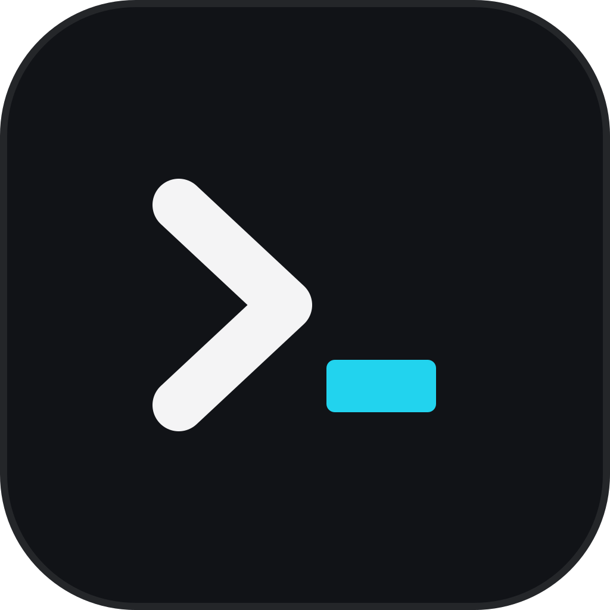

<p align="center">
  
</p>

<h1 align="center">Kai Terminal</h1>

<p align="center">
  One terminal. Every platform.<br>
  A fast desktop terminal for Windows, Linux and macOS, with a local CLI that gives your AI coding tools project context.
</p>

<p align="center">
  <a href="https://github.com/surajthaqurie/kai-terminal/actions"></a>
  <a href="LICENSE"></a>
  <a href="https://github.com/surajthaqurie/kai-terminal/releases/latest"></a>
  <a href="https://kai-terminal.vercel.app/"></a>
</p>

<p align="center">
  <a href="https://github.com/surajthaqurie/kai-terminal/releases/latest">Download</a> ·
  <a href="https://kai-terminal.vercel.app/">Website</a> ·
  <a href="https://kai-terminal.vercel.app/guide">Setup guide</a> ·
  <a href="USER_MANUAL.md">User manual</a> ·
  <a href="CHANGELOG.md">Changelog</a>
</p>

---

## Contents

- [Overview](#overview)
- [Installation](#installation)
- [Quick start](#quick-start)
- [Kai CLI](#kai-cli)
- [MCP server](#mcp-server)
- [Integrations](#integrations)
- [Shared Agent](#shared-agent)
- [Using the app](#using-the-app)
- [Privacy and security](#privacy-and-security)
- [Development](#development)
- [Documentation](#documentation)
- [Support](#support)
- [License](#license)

## Overview

Kai is a desktop terminal built on **Tauri 2**, **Rust** (`portable-pty`) and a WebGL-accelerated renderer (`xterm.js`). It ships with a companion CLI that indexes your projects locally and serves compact, budgeted context to AI coding tools over the Model Context Protocol (MCP).

- **Cross-platform:** Windows 10/11, macOS 12+ and Linux (x64 and ARM64), one consistent experience.
- **AI-ready:** `kai <agent>` wires your AI CLI to Kai MCP, builds a symbol and import graph, and runs the agent in your project.
- **Local and private:** indexes live in `~/.kai/`, source files are never modified or executed, and there is no account and no telemetry.
- **Integrated workflow:** Azure DevOps work items, pull requests and builds for your agents; Microsoft Teams chat in a tab; encrypted agent sharing between your own PCs.
- **Themeable:** a design system with a theme registry, bundled Inter and JetBrains Mono fonts, and remappable shortcuts.

## Installation

Download the installer for your system from the [latest release](https://github.com/surajthaqurie/kai-terminal/releases/latest).

| OS                        | File                                                                              | Install                                            |
| ------------------------- | --------------------------------------------------------------------------------- | -------------------------------------------------- |
| macOS 12+ (Apple silicon) | `kai_0.2.3_aarch64.dmg`                                                           | Open the `.dmg`, drag `Kai.app` to `/Applications` |
| macOS 12+ (Intel)         | `kai_0.2.3_x64.dmg`                                                               | Same as above                                      |
| Windows 10/11 x64         | `kai_0.2.3_x64-setup.exe`                                                         | Download and run                                   |
| Windows x64 (admin)       | `kai_0.2.3_x64_en-US.msi`                                                         | Silent and administrator installs                  |
| Windows 11 ARM64          | `kai_0.2.3_arm64-setup.exe`                                                       | Download and run                                   |
| Linux x64 (Debian/Ubuntu) | `kai_0.2.3_amd64.deb`                                                             | `sudo apt install ./kai_0.2.3_amd64.deb`           |
| Linux x64 (Fedora/RHEL)   | `kai-0.2.3-1.x86_64.rpm`                                                          | `sudo dnf install ./kai-0.2.3-1.x86_64.rpm`        |
| Linux x64 (any distro)    | `kai_0.2.3_amd64.AppImage`                                                        | `chmod +x kai_*.AppImage && ./kai_*.AppImage`      |
| Linux ARM64               | `kai_0.2.3_arm64.deb` · `kai-0.2.3-1.aarch64.rpm` · `kai_0.2.3_aarch64.AppImage` | Same as above, ARM build                           |

See [INSTALL.md](INSTALL.md) for details and troubleshooting. Kai checks for updates itself (**Settings → Updates**).

## Quick start

1. Install and open Kai Terminal.
2. Check your setup: `kai health` (or `kai doctor` for PATH and desktop diagnostics).
3. Start an AI tool in your project:

   ```bash
   cd your-project
   kai claude .        # or: kai opencode . · kai cursor . · kai codex .
   ```

   Kai wires the MCP configuration if needed, enters Code Mode, builds the project graph, runs the agent, and syncs graph changes when it exits.

4. From any other terminal, `kai open [path]` launches or focuses the desktop app.

## Kai CLI

The CLI indexes projects into `~/.kai/` (outside your repository) and is read-only on your sources. Project intelligence and agent commands run inside Kai Terminal (`KAI_TERMINAL=1`); the commands in the first block work from any terminal. Full syntax is in [USER_MANUAL.md](USER_MANUAL.md).

**Any terminal**

```bash
kai open [path]                    # launch or focus Kai Terminal (defaults to current dir)
kai health                         # system readiness
kai doctor                         # environment, PATH and desktop diagnostics
kai list [-a|-m|-i|-s|-c]          # tools (-a), MCP (-m), projects (-i), sessions (-s), config (-c)
kai integration [list|azure|teams] # inspect or connect integrations
kai azure [list|active|remove]     # Azure DevOps projects for this folder
kai remove [-m|-a|-i|-s]           # un-wire tools, or delete index/session data
kai remove --name <id>             # remove an integration account everywhere
kai close                          # close active Kai Terminal instances
```

**Inside Kai Terminal**

```bash
kai <agent> [path]         # run an AI tool: wire MCP, enter Code Mode, build and sync the graph
kai agent add <agent|all>  # wire tools to Kai MCP (aliases: kai setup, kai mcp)
kai agent remove <agent>   # un-wire a tool
kai graph init .           # build the symbol index and import graph
kai graph update .         # force a rebuild
kai graph status .         # index status and symbol counts
kai graph prune            # drop maps of deleted folders and sub-folders
kai teams                  # Microsoft Teams chat in this tab
kai stop                   # leave Code Mode
kai lsp                    # probe installed language servers
kai metrics                # local performance and token diagnostics
kai bench .                # measure query speed on this machine
```

### Supported agents

All ten agents share one registry (`src/core/agents.ts`). Detection is dynamic: `kai list` probes your `PATH` and known config files at runtime.

| Agent             | Config file                                                   | Entry                                         |
| ----------------- | ------------------------------------------------------------- | --------------------------------------------- |
| Claude Code       | `~/.claude.json` (global) or `.mcp.json` (project)            | `mcpServers["kai-terminal"]` stdio            |
| Cursor            | `~/.cursor/mcp.json` (global) or `.cursor/mcp.json` (project) | uses `${workspaceFolder}`                     |
| Codex             | `~/.codex/config.toml`                                        | `[mcp_servers.kai-terminal]`                  |
| Gemini CLI        | `~/.muse/settings.json`                                       | `mcpServers["kai-terminal"]` stdio            |
| Copilot / VS Code | `.vscode/mcp.json` (project)                                  | `servers["kai-terminal"]`, `"type": "stdio"`  |
| Windsurf          | `~/.codeium/windsurf/mcp_config.json`                         | `mcpServers["kai-terminal"]` stdio            |
| Cline             | VS Code global storage `cline_mcp_settings.json`              | skipped with manual steps if VS Code is absent |
| opencode          | `~/.config/opencode/opencode.json`                            | `mcp["kai-terminal"]`, `"type": "local"`      |
| Aider             | `~/.config/aider/mcp.json`                                    | `mcpServers["kai-terminal"]` stdio            |
| Antigravity (agy) | `~/.gemini/antigravity-cli/settings.json`                     | `mcpServers["kai-terminal"]` stdio            |

The desktop app also lists installed CLIs without running them, shows each one's wiring state, and offers one-click **Auto-wire Kai MCP**.

## MCP server

Kai serves project context over stdio MCP. All tools are read-only on project sources.

| Tool                   | Purpose                                                                                                   |
| ---------------------- | --------------------------------------------------------------------------------------------------------- |
| `kai_project_info`     | Metadata, file counts, language breakdown                                                                 |
| `kai_search_code`      | Ranked symbol search (metadata only; `includeSource: true` adds snippets)                                 |
| `kai_read_range`       | Read one symbol or line range                                                                             |
| `kai_find_symbol`      | Function, class and struct locations with line ranges                                                     |
| `kai_get_dependencies` | Import graph                                                                                              |
| `kai_get_context`      | Budgeted context for a task; an exact symbol name anchors it, with callers and tests added within a cap   |
| `kai_refresh_index`    | Re-index after changes                                                                                    |
| `kai_get_lsp_status`   | Status of local language servers (`typescript-language-server`, `rust-analyzer`, `pyright`, `gopls`)      |
| `kai_plan_task`        | Code Mode task planning with project context                                                              |
| `kai_sync_graph`       | Guarded post-change graph validation and freshness sync                                                   |

Entering Code Mode (`kai <agent>` or `kai graph init .`) also installs a self-contained `commit-msg` hook so commits from any agent carry no `Co-authored-by:` trailers. The hook is POSIX sh, works on every platform, fails open, and chains any existing hook. To remove it, delete `.git/hooks/commit-msg` (and rename `commit-msg.kai-orig` back if your own hook was preserved).

Reference: [MCP.md](MCP.md).

## Integrations

Integrations are opt-in and are the only features that contact an outside service, using only the sign-in you provide.

### Azure DevOps

Connect a folder so your AI tools can read its work items, pull requests and builds through the same MCP server. The setup is one command and is safe to re-run.

```bash
kai integration list                 # every integration and its state for this folder
kai integration azure                # sign in, connect this folder, wire agents, verify with real calls
kai azure list                       # accounts and projects; * marks this folder's active project
kai azure active --name Payments     # switch this folder's active project
kai azure remove                     # disconnect this folder (your sign-in stays)
kai remove --name contoso            # remove the account everywhere
```

- **Auto-detected:** organization, project and repository come from the folder's git remotes (Azure DevOps Services and Server HTTPS remotes) and are verified against Azure.
- **One active project per folder.** Sign-in is per user. The connection is a private file under `~/.kai/projects/`, never in your repository.
- **Tokens stay safe:** the Azure CLI is used when installed; otherwise the token goes to the OS secret store (Windows DPAPI, macOS Keychain, Linux Secret Service), never to a repository or agent config. Work item searches are scoped to the active project.
- **Read-only tools, only where connected:** `kai_integration_status`, `kai_workflow_rules`, `kai_work_item_search`, `kai_work_item_get`, `kai_pr_list`, `kai_pr_get`, `kai_build_list`, `kai_build_log`.
- **Write tools, off by default:** `kai integration azure --allow-writes` (run by you; refused inside an agent session) adds `kai_work_item_comment`, `kai_work_item_set_state`, `kai_work_item_create`, `kai_work_item_update`, `kai_pr_create` and `kai_pr_comment`. They never create branches, merge or delete. `--no-writes` removes them.
- **Workflow rules:** set a merge branch and a branch-naming regex per folder (`--merge-branch`, `--branch-pattern`, plus `--clear-merge-branch` and `--clear-branch-pattern`). Agents read them via `kai_workflow_rules`; Kai never blocks a commit or push.
- **Desktop app:** the **Integrations** tab of the AI Providers panel (robot icon) offers the same actions, grouped by account.

### Microsoft Teams

Read and answer your Teams chats without leaving the terminal. It uses your own account, shared by every terminal, and is not tied to a folder or an agent.

```bash
kai integration teams              # sign in with your Microsoft account, check access
kai integration teams --channels   # add channel messages once an administrator approved them
kai teams                          # open the chat in this tab
kai integration teams remove       # sign out and forget the account
```

- Fully clickable and keyboard driven: `Enter` sends, `Ctrl+J` adds a new line, `Up`/`Down` switch conversation, `PageUp`/`PageDown` scroll, `Esc` leaves.
- Images show inline in capable terminals (iTerm2, WezTerm, mintty, Kai Terminal). Paste an image or file with `Ctrl+V` or click **Attach**; up to 4 items, files up to 2 GB are shared as OneDrive links.
- The open conversation refreshes every few seconds, the chat list every 20 seconds, and **●** marks unread chats.
- Uses Microsoft Graph with your own permissions. The token goes to the OS secret store.
- Teams is not an MCP integration: no agent tool exists for it, and both Teams commands refuse to run inside an agent session.
- Sign-in needs a build that carries Kai's Microsoft Entra client ID. Maintainers: [docs/microsoft-sign-in-setup.md](docs/microsoft-sign-in-setup.md).

## Shared Agent

Use the Claude Code or OpenCode on another PC from this one, or let your other PCs use yours. Open **AI Providers → Shared Agent**. A green dot on the AI Providers icon shows while sharing is on.

- **Share my agent:** turn sharing on, choose agents and port, and generate an invite link. A link works once and expires after 5, 15 or 60 minutes, or stays valid until sharing stops. Each connected PC has its own permissions (agents, model, time limit per run), usage table and recent tasks, and can be removed at any time.
- **Use a shared agent:** paste the invite link on the other PC and chat in the panel or a pop-out window. Answers stream as they are written.
- **Encrypted, Kai to Kai only:** peers handshake with X25519 keys and traffic is end-to-end encrypted.
- **Read-only, always:** a shared agent runs in an empty folder. It cannot read your files, run commands or use MCP tools, and no setting changes this.
- **Private by default:** sharing is off whenever Kai starts, and only PCs on your own network can join. To reach PCs elsewhere, point an HTTPS tunnel at the port Kai shows; Kai never opens one for you.
- **Never port-forward** the sharing port. See [SECURITY.md](SECURITY.md).

## Using the app

The window has three bands: a header row, the terminal panes, and a status bar.

- **Header:** tabs (`+` for a new tab, `▾` to pick a shell), the command palette (`Ctrl+Shift+P`), AI Providers, Settings (`Ctrl+,`), and the `⋯` menu for workspaces, git review, splits, diagnostics and updates.
- **Several windows:** `Ctrl+Shift+N` (or **New window** in the `⋯` menu and the palette) opens another Kai window, like a second editor window; launching the app again does the same. Drag a tab out of the tab bar and release to move it into its own window, **with its shell still running** (scrollback and any running command come along). **Move tab to new window** in the tab's right-click menu does the same without dragging. Closing a window ends only its shells; the app quits when the last window closes. The first window keeps the saved layout, the music player and update checks.
- **Status bar:** shell picker, Code Mode / Terminal pill with an editor menu, git branch (click or `Ctrl+Shift+G` to review changes), the music mini-player while one plays, and the version with update check.
- **Open in editor:** click the mode pill or pick an editor from its menu (VS Code, Cursor, Windsurf, VSCodium, Sublime Text, Zed, Atom, IntelliJ IDEA, Fleet, WebStorm, CLion). Set the default in **Settings → Shell & Tools**. Kai also adds a **Kai Terminal** profile to VS Code, Cursor, VSCodium and Windsurf (`KAI_NO_EDITOR_PROFILE=1` disables it).
- **Appearance:** **Settings → Font & Display** and **Appearance** control font, size, scrollback, padding, theme and opacity. See [docs/THEMES.md](docs/THEMES.md) and [docs/DESIGN_SYSTEM.md](docs/DESIGN_SYSTEM.md).
- **Links and files:** `Ctrl+click` (`Cmd+click` on macOS) opens links. Pasting copied files inserts their quoted paths.

### Keyboard shortcuts

On macOS use `Cmd` where `Ctrl` is shown. Plain `Ctrl+C` and `Ctrl+V` always reach the shell. Every shortcut is remappable in **Settings → Shortcuts**, except `Ctrl/Shift+Insert`, `Shift+PageUp`/`PageDown`, `Ctrl+Shift+G` and `Ctrl+Shift+N`.

| Keys                              | Action                                         |
| :-------------------------------- | :--------------------------------------------- |
| `Ctrl+Shift+C` / `Ctrl+Shift+V`   | Copy / paste                                   |
| `Ctrl+Shift+A` / `Ctrl+Shift+K`   | Select all / clear the terminal                |
| `Ctrl+Shift+F`                    | Find in output                                 |
| `Ctrl+Shift+P`                    | Command palette                                |
| `Ctrl+Shift+T` / `Ctrl+Shift+W`   | New tab / close tab                            |
| `Ctrl+Tab` / `Ctrl+Shift+Tab`     | Next / previous tab                            |
| `Ctrl+1` … `8`, `Ctrl+9`          | Jump to a tab / the last tab                   |
| `Alt+Shift+=` / `Alt+Shift+-`     | Split side by side / stacked                   |
| `Alt+Shift+W`                     | Close the active pane                          |
| `Alt+Shift+]` / `Alt+Shift+[`     | Focus next / previous pane                     |
| `Ctrl+=` / `Ctrl+-` / `Ctrl+0`    | Zoom in / out / reset                          |
| `Ctrl+Shift+G`                    | Review git changes                             |
| `Ctrl+Shift+N`                    | New window                                     |
| `Ctrl+,`                          | Settings                                       |
| `Ctrl+Shift+M`                    | Show / hide the music player                   |

Defaults follow Windows Terminal and avoid `Ctrl+Alt`, which Windows reports as AltGr. Upgrading users keep any shortcut they set themselves; unchanged defaults move to the new keys once.

## Privacy and security

- Indexed source files are never executed. `.env*`, keys and binaries are skipped by default.
- MCP input is size-capped before parsing, and retrieval checks file hashes and warns on stale indexes.
- Indexes live in `~/.kai/`; `kai remove` deletes them. Diagnostics go to `~/.kai/metrics.jsonl`.
- No account and no telemetry in the app. The code-map tools never touch the network.
- Shared Agent opens a listener only while you have sharing turned on in the current session. `kai remove --name <id>` deletes an Azure DevOps sign-in and token; `kai integration teams remove` does the same for Teams.

To report a vulnerability, see [SECURITY.md](SECURITY.md).

## Development

**Prerequisites:** Node 20+ and Rust 1.75+. Linux also needs:

```bash
sudo apt-get install -y build-essential pkg-config libssl-dev libwebkit2gtk-4.1-dev libgtk-3-dev libayatana-appindicator3-dev librsvg2-dev
```

```bash
git clone https://github.com/surajthaqurie/kai-terminal.git
cd kai-terminal
npm install
npm run tauri dev      # desktop app with hot reload
```

| Script                 | Purpose                                                    |
| ---------------------- | ---------------------------------------------------------- |
| `npm run dev`          | Browser build with a mock PTY                              |
| `npm run tauri build`  | Production bundles in `src-tauri/target/release/bundle/`   |
| `npm run check`        | Type check, formatting and tests                           |
| `npm run prepush`      | Full pre-push gate, including Rust fmt, clippy and tests   |
| `npm run test:docker`  | Run the suites in Docker                                   |

More in [DEVELOPMENT.md](DEVELOPMENT.md), [ARCHITECTURE.md](ARCHITECTURE.md) and [TEST_PLAN.md](TEST_PLAN.md).

## Documentation

[INSTALL](INSTALL.md) · [USER_MANUAL](USER_MANUAL.md) · [MCP](MCP.md) · [DEVELOPMENT](DEVELOPMENT.md) · [ARCHITECTURE](ARCHITECTURE.md) · [SECURITY](SECURITY.md) · [TEST_PLAN](TEST_PLAN.md) · [KNOWN_LIMITATIONS](KNOWN_LIMITATIONS.md) · [RELEASE_GUIDE](RELEASE_GUIDE.md) · [CHANGELOG](CHANGELOG.md)

## Support

Found a bug or have a request? [Open an issue](https://github.com/surajthaqurie/kai-terminal/issues) with your OS, Kai version and steps to reproduce. Run `kai doctor` and include its output when the problem is environment related. Current gaps are listed in [KNOWN_LIMITATIONS](KNOWN_LIMITATIONS.md).

## License

[MIT](LICENSE). Free for personal and commercial use.
