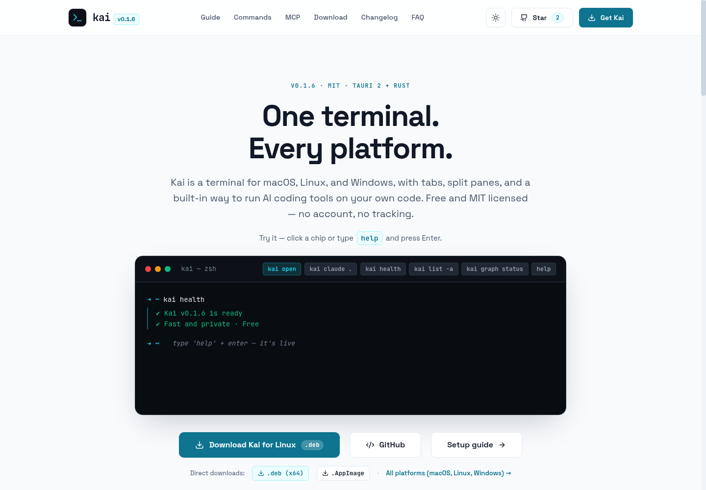

# kai — One terminal. Every platform.

[](https://github.com/surajthaqurie/kai-terminal/actions)
[](LICENSE)
[](https://github.com/surajthaqurie/kai-terminal/releases/latest)
[](https://kai-terminal.vercel.app/)

Desktop terminal for **Windows · Linux · macOS**, plus a local CLI for AI context.
Tauri 2 + Rust (`portable-pty`) + WebGL GPU terminal renderer (`xterm.js`). MIT licensed, no account.

Live site: **https://kai-terminal.vercel.app/** · Releases: [latest](https://github.com/surajthaqurie/kai-terminal/releases/latest)

> Status: v0.2.1 is an active release. If something breaks, please open an issue with OS, version and steps to reproduce.

<a href="https://kai-terminal.vercel.app/">
  <picture>
    <source media="(prefers-color-scheme: dark)" srcset="docs/screenshot-dark.png">
    <source media="(prefers-color-scheme: light)" srcset="docs/screenshot-light.png">
    
  </picture>
</a>

<p align="center">
  <a href="https://github.com/surajthaqurie/kai-terminal/releases/latest"></a>
  <a href="https://kai-terminal.vercel.app/"></a>
  <a href="https://kai-terminal.vercel.app/guide"></a>
</p>

<sub>The screenshot follows your GitHub theme: dark (Settings → Appearance) shows the dark hero, light shows the light one.</sub>

## Download — you pick the file

No auto-detection here. All installers are published on [GitHub Releases](https://github.com/surajthaqurie/kai-terminal/releases/latest). Pick your own:

| OS                  | File                                | Install                                            |
| ------------------- | ----------------------------------- | -------------------------------------------------- |
| macOS 12+ (M1–M4)   | `kai_0.2.1_aarch64.dmg`             | Open the `.dmg`, drag `Kai.app` to `/Applications` |
| Linux x64           | `kai_0.2.1_amd64.deb`               | `sudo dpkg -i kai_0.2.1_amd64.deb`                 |
| Linux (any distro)  | `kai_0.2.1_amd64.AppImage`          | `chmod +x kai_*.AppImage && ./kai_*.AppImage`      |
| Linux ARM64         | `kai_0.2.1_arm64.deb` / `.AppImage` | Same as above, ARM build                           |
| Windows 10/11 x64   | `kai_0.2.1_x64-setup.exe`           | Download and run                                   |
| Windows x64 (admin) | `kai_0.2.1_x64_en-US.msi`           | For silent/admin installs                          |

The website lists the same files and does not choose for you. If your browser guessed wrong, just click another tab — nothing is locked in.

## Run from source

```bash
git clone https://github.com/surajthaqurie/kai-terminal.git
cd kai-terminal
npm install
npm run tauri dev   # desktop, hot reload
```

Prereqs: Node 20+ · Rust 1.75+. Linux also needs:

```bash
sudo apt-get install -y build-essential pkg-config libssl-dev libwebkit2gtk-4.1-dev libgtk-3-dev libayatana-appindicator3-dev librsvg2-dev
```

Other scripts: `npm run dev` (browser mock PTY) · `npm run tauri build` (bundles in `src-tauri/target/release/bundle/`) · `npm run check` (lint+types+tests).

## Kai CLI — local index + MCP

Kai ships a CLI that indexes projects into `~/.kai/` (outside your repo) and serves context to AI tools over stdio MCP. Read-only — your source code is never modified.

> **Environment Note**: Project intelligence and agent execution commands run inside Kai Terminal (`KAI_TERMINAL=1`). Outside Kai Terminal, use `kai open [path]` to launch or focus Kai Terminal. See [USER_MANUAL.md](USER_MANUAL.md) for full documentation.

### External Commands (Any Terminal)

```bash
kai open [path]           # launch or focus Kai Terminal desktop app (defaults to current dir)
kai health                # check system readiness and health
kai doctor                # run environment, PATH, and desktop diagnostics
kai list [-a|-m|-i|-s|-c] # look up tools (-a), MCP (-m), projects (-i), sessions (-s), config (-c)
kai remove [-m|-a|-i|-s]  # un-wire tools (-m/-a <name>) or delete index (-i)/session (-s) data
kai remove --name <id>    # remove an integration account everywhere (token + every folder)
kai close                 # close active Kai Terminal instances
```

### Inside Kai Terminal

```bash
kai <agent> [path]        # run an AI tool: auto-wires MCP, enters Code Mode, builds & syncs graph
kai agent add <agent|all> # wire tool(s) to Kai MCP (aliases: kai setup, kai mcp)
kai agent remove <agent>  # un-wire tool from Kai MCP (or kai remove -a/-m)
kai graph init .          # initialize the symbol index and import graph
kai graph update .        # force update and rebuild of project graph
kai graph status .        # show graph index status and symbol counts
kai stop                  # clear Code Mode and return to plain terminal
kai lsp                   # probe locally installed Language Server Protocol servers
kai metrics               # view local performance and token diagnostics
```

`kai <agent> [path]` (e.g. `kai claude .`, `kai opencode .`, `kai cursor .`) automatically
wires Kai MCP configuration if needed, activates Code Mode, generates the
project graph, runs the agent inside the project directory, and auto-syncs graph changes on exit.
Detailed guide and syntax: see [USER_MANUAL.md](USER_MANUAL.md).

### Supported agents

| Agent             | Config file                                                   | Notes                                            |
| ----------------- | ------------------------------------------------------------- | ------------------------------------------------ |
| Claude Code       | `~/.claude.json`                                              | `mcpServers["kai-terminal"]` stdio entry                     |
| Cursor            | `~/.cursor/mcp.json` (global) or `.cursor/mcp.json` (project) | uses `${workspaceFolder}`                        |
| Codex             | `~/.codex/config.toml`                                        | `[mcp_servers.kai-terminal]` section             |
| Gemini CLI        | `~/.muse/settings.json`                                       | `mcpServers["kai-terminal"]` stdio entry                     |
| Copilot / VS Code | `.vscode/mcp.json` (project)                                  | `servers["kai-terminal"]` with `"type": "stdio"`             |
| Windsurf          | `~/.codeium/windsurf/mcp_config.json`                         | `mcpServers["kai-terminal"]` stdio entry                     |
| Cline             | VS Code global storage `cline_mcp_settings.json`              | skipped with manual steps when VS Code is absent |
| opencode          | `~/.config/opencode/opencode.json`                            | `mcp["kai-terminal"]` with `"type": "local"`                 |
| Aider             | `~/.config/aider/mcp.json`                                    | `mcpServers["kai-terminal"]` stdio entry                     |
| Antigravity (agy) | `~/.gemini/antigravity-cli/settings.json`                     | `mcpServers["kai-terminal"]` stdio entry                     |

Agent detection is dynamic: `kai list` probes the live system
PATH plus known config files at runtime, so newly installed agents show
up without any code changes. All 10 agents share one registry
(`src/core/agents.ts`).

The desktop app also lists locally installed CLIs
(`codex`, `claude`, `gemini`, `opencode`, `copilot`, `aider`, `cursor`,
`windsurf`, `cline`, `agy`) without
running them — missing tools report `available: false`. Each provider row
shows its kai wiring state and offers one-click **Auto-wire Kai MCP** for
system-installed tools.

### Notes on speed

Measured on the maintainer's machine: local queries typically complete in a few ms.
Your numbers will differ by repo size and hardware — run `kai bench .` to check.

### MCP tools (stdio)

- `kai_project_info` — metadata, file counts, language breakdown.
- `kai_search_code` — ranked symbol search (metadata only; `includeSource: true` adds snippets).
- `kai_read_range` — read one symbol or line range.
- `kai_find_symbol` — function/class/struct locations with line ranges.
- `kai_get_dependencies` — import graph.
- `kai_get_context` — budgeted context for a task (an exact symbol name anchors it; callers and tests of that symbol are added within a cap for refactor, debug, implement and test tasks).
- `kai_refresh_index` — re-index after changes.
- `kai_get_lsp_status` — local language server status (`typescript-language-server`, `rust-analyzer`, `pyright`, `gopls`).
- `kai_plan_task` — Code Mode task planning with project context and prompt options.
- `kai_sync_graph` — guarded post-change graph validation and freshness sync.

All tools are read-only on project sources. Hands-free co-author prevention needs no tool:
entering Code Mode (e.g. `kai <agent>` or `kai graph init .`) installs a self-contained `commit-msg`
hook into the repo, so every future commit from any agent lands without
`Co-authored-by:` trailers. The hook is POSIX sh only (Linux, macOS,
Windows), fails open, and preserves/chains any pre-existing hook.
To remove the hook later, delete
`.git/hooks/commit-msg` (and rename `commit-msg.kai-orig` back to
`commit-msg` if your own hook was preserved there).

The status bar in the app shows the indexed project, file/symbol counts and last query cost.

### Integrations (Azure DevOps)

Connect a folder to Azure DevOps and your AI tools can read its work items, pull requests and builds through the same `kai mcp` server. One command does the setup, and it is safe to run again:

```bash
# Run these in a Kai Terminal tab. Organization, project and repository come from the folder's git remote.
kai integration list       # every integration and its state for this folder
kai integration azure      # sign in, connect this folder, wire your agents, verify with real calls
kai azure list             # accounts and their projects; * marks this folder's active project
kai azure active --name Payments   # switch this folder's active project
kai azure remove           # disconnect this folder (your sign-in stays)
kai remove --name contoso  # remove the account everywhere: token and every folder's connection
```

- **Auto-detected:** organization, project and repository come from the folder's git remotes (Azure DevOps Services and Azure DevOps Server HTTPS remotes), from any sub-folder. Names are checked against what Azure really has.
- **One active project per folder.** Sign-in is per user and shared by every folder. The connection is a private file under `~/.kai/projects/`, never in your repository.
- **Tokens stay safe:** the Azure CLI is used when installed, so Kai stores nothing; otherwise an access token goes to the OS secret store (Windows DPAPI, macOS Keychain, Linux Secret Service), never to a repository or an agent config.
- **Read-only tools, added only where connected:** `kai_integration_status`, `kai_work_item_search`, `kai_work_item_get`, `kai_pr_list`, `kai_pr_get`, `kai_build_list`, `kai_build_log`. A folder that is not connected sees exactly the tools listed above. Text from Azure is returned as untrusted data. Restart a running agent session after setup so it re-reads its tools.
- **Desktop app:** the **Integrations** tab of the AI CLI providers panel (robot icon) offers the same actions, including switching the project.

Details: [MCP.md](MCP.md) · [USER_MANUAL.md](USER_MANUAL.md).

### Keyboard shortcuts

On macOS use `Cmd` where `Ctrl` is shown. Plain `Ctrl+C` always stays the shell interrupt, and plain `Ctrl+V` always reaches the shell.

| Keys | Action |
| :--- | :--- |
| `Ctrl+Shift+C` (or `Ctrl+Insert`) | Copy the selection |
| `Ctrl+Shift+V` (or `Shift+Insert`) | Paste |
| `Ctrl+Shift+A` | Select all output |
| `Ctrl+Shift+K` | Clear the terminal |
| `Ctrl+Shift+Home` / `End` | Scroll to the top / bottom |
| `Shift+PageUp` / `PageDown` | Scroll one page |
| `Ctrl+=` / `Ctrl+-` / `Ctrl+0` | Zoom the font in / out / back to the saved size (this session only) |
| `Ctrl+1` … `8`, `Ctrl+9` | Jump to that tab, or to the last tab |
| `Ctrl+Shift+T` / `W` | New tab / close tab |
| `Ctrl+Shift+P` | Command palette |
| `Ctrl+Shift+F` | Find in output |
| `Ctrl+Shift+G` | Review git changes |

Every shortcut above is remappable in **Settings → Shortcuts** except `Ctrl/Shift+Insert`, `Shift+PageUp` / `PageDown` and `Ctrl+Shift+G`, which stay fixed and are listed there read-only. `Ctrl+T` also always opens a new tab, so Settings will not let you bind `Ctrl+T`, `Ctrl+Shift+T` (other than to New tab) or `Ctrl+Shift+G` to anything else. Music Time pauses for calls automatically.

### Privacy and limits

- Indexed source files are never executed.
- `.env*`, keys and binaries are skipped by default.
- MCP input is size-capped before parsing.
- Retrieval checks file hashes and warns on stale indexes.
- Indexes live in `~/.kai/`; `kai remove` deletes them.
- Local diagnostics go to `~/.kai/metrics.jsonl`. No account, no telemetry in the app.
- The code-map tools never touch the network. Integrations are opt-in per folder: `kai integration azure` is the only thing that contacts an outside service, only with the sign-in you give it, and `kai remove --name <id>` deletes that sign-in and its stored token.

See [KNOWN_LIMITATIONS](KNOWN_LIMITATIONS.md) for what v0.2.1 does not do yet.

## Docs

[INSTALL](INSTALL.md) · [DEVELOPMENT](DEVELOPMENT.md) · [ARCHITECTURE](ARCHITECTURE.md) · [SECURITY](SECURITY.md) · [TEST_PLAN](TEST_PLAN.md) · [KNOWN_LIMITATIONS](KNOWN_LIMITATIONS.md)

## License

MIT — see [LICENSE](LICENSE). Free for personal + commercial use.
